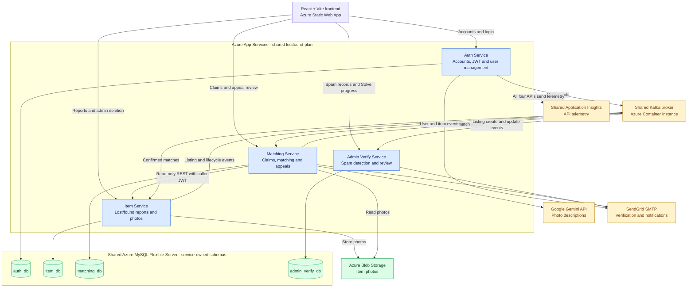
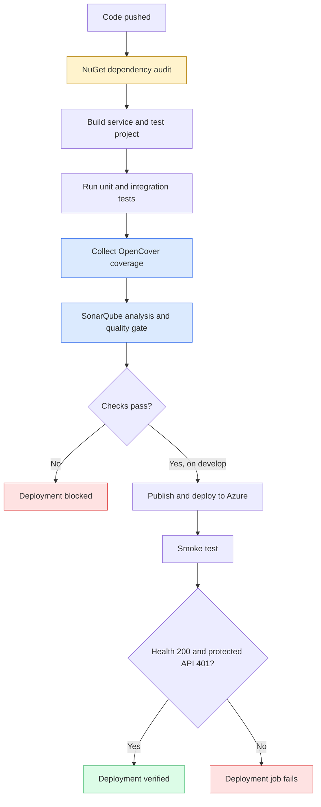
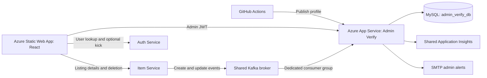

# Back2U Lost & Found App

A lost-and-found platform built as a microservice system: independent services per domain (auth, items, matching, admin moderation), talking to each other asynchronously over Kafka instead of direct service-to-service calls (with one narrow, read-only exception, see [Architecture](#architecture)), with a single React SPA as the one frontend for all of them.

## Status (Sprint 4)

All four backend services are built, tested and deployed. Sprint 4 DevOps setup and evidence are documented in [Admin Verify Service](#admin-verify-service---sprint-4-devops).

| Service | Status |
|---|---|
| Auth Service | ✅ Built, tested, deployed (Sprint 1) - registration, email OTP verification, login/JWT, password reset, profile update, admin user management (list/kick/unkick) |
| Item Service | ✅ Built, tested, deployed (Sprint 2) - report lost/found items with a photo, edit, search/filter, view details, mark resolved, soft-delete, "my reports"; transactional outbox publishing `items.*` events; consumes `matches.confirmed` |
| Matching Service | ✅ Built, tested, deployed (Sprint 3) - AI image descriptions (Gemini), claim preview + scoring, two-sided confirm/reject, contact hand-off, confirmed-match events, email notifications, match re-evaluation and lifecycle handling |
| Admin Verify Service | ✅ Built, tested, deployed (Sprint 4) - Kafka listing intake, spam detection, admin alerts, record review, Open, Dismiss and resumable Solve; SonarQube, coverage, dependency audit and deployment smoke tests |
| Frontend | ✅ Deployed - Auth, Item, Matching, match appeals, admin user management and Spam Review; connected to the deployed Admin Verify API |

## Architecture

Microservices, no API gateway - the frontend calls each service's own base URL directly. Cross-service *state changes and signals* go through a shared, self-hosted Kafka broker. Each service owns its own MySQL schema.



Solid arrows show API calls, database/storage access and event delivery; the dotted arrow shows telemetry. The frontend calls each API directly over HTTPS in Azure, passing JWTs for protected requests. During Solve, it also calls Auth Service for an optional user kick; Admin Verify saves progress rather than performing the deletion or kick itself. Kafka topic ownership is detailed below; deployment automation is documented in [CI/CD](#cicd).

**Authentication across services.** Auth Service issues the JWT; every other service validates it locally with the shared `Jwt:Secret`/`Issuer`/`Audience` (no call back to Auth). The frontend sends `Authorization: Bearer <jwt>` to Item, Matching and Admin Verify Services. Matching Service additionally requires the `email_verified=1` claim (policy `VerifiedClaimUser`); Admin Verify uses the `AdminOnly` policy.

**Sprint 4 extension.** Admin Verify runs on Azure App Service with its own `admin_verify_db`, consumes Item create/update events from Kafka, and uses the shared Application Insights resource. The frontend coordinates admin listing deletion through Item Service and optional user kicks through Auth Service, saving progress in Admin Verify. See the [Sprint 4 deployment diagram](#sprint-4-deployment-topology).

**Where Matching Service does call another service synchronously.** To preview or submit a claim, Matching Service reads the two reports from Item Service over REST (`GET /api/items/{lost|found}/{id}` and `/mine`), forwarding the caller's own JWT so Item Service's normal authorization applies. This is read-only - Matching never writes to Item Service over REST. Every *write* that crosses the boundary (e.g. resolving the two reports after a confirmed match) is a Kafka event.

### Kafka topics

Topic names are `{TopicPrefix}.{event}`; delivery is at-least-once, so consumers de-duplicate on `EventId`.

| Topic | Producer | Consumers | Purpose |
|---|---|---|---|
| `auth.user.verified` / `.profile_updated` / `.kicked` / `.unkicked` / `.deleted` | Auth | Matching (notification contacts, only when `Notifications:Enabled`) | Keep a local email/active/deleted copy of each user for notifications |
| `items.lost_item.created` / `.updated` | Item | Matching, Admin Verify | Image-description jobs and match re-evaluation; listing intake and spam detection |
| `items.found_item.created` / `.updated` | Item | Matching, Admin Verify | Same, for found reports |
| `items.lost_item.resolved` / `items.found_item.resolved` | Item | Matching | Deactivate matches on a resolved report |
| `items.item.delete_requested` | Item (lost *and* found delete) | Matching | Deactivate matches on a deleted report |
| `matches.confirmed` | Matching | Item | Both parties confirmed - Item Service marks both reports `RESOLVED` |

Reliability patterns used by both new services:

- **Item Service - transactional outbox.** Controllers write the event to `outbox_events` in the same DB transaction as the item change; `OutboxRelayService` publishes to Kafka with retry/backoff and a short lease so several instances never double-publish.
- **Matching Service - confirmation outbox.** `matches.confirmed` is written to `match_confirmation_outbox` in the same transaction as the match reaching `CONFIRMED`, then published by `MatchConfirmationPublisher`.
- **Item Service - inbox.** `match_resolution_inbox` makes `matches.confirmed` handling idempotent; the Kafka offset is committed only after the DB transaction commits.

Item events carry `HiddenInformation` (the owner-only verification detail) for Matching's use. See [Known limitations](#known-limitations) for the broker-security caveat.

Full reasoning behind each infrastructure choice, the deployment topology, and the complete resource inventory live in `DevOps_Documentation/`:
`Sprint1-DevOps-Technical-Documentation.md` (shared infra, Auth) and `Sprint2-DevOps-Technical-Documentation.md` (Item Service, Blob Storage, cross-service auth).

## Item Service (`services/ItemService`)

.NET 8 Web API, raw ADO.NET (parameterized SQL, no ORM), MySQL `item_db`, Azure Blob Storage for photos.

**Data model.** `lost_items`, `lost_item_photos`, `found_items`, `found_item_photos` (soft-delete via `deleted_at`), plus `outbox_events` and `match_resolution_inbox`. Statuses: `ACTIVE`, `MATCHED`, `CLOSED`, `RESOLVED`. Categories: Electronics, Bags, Clothing, Accessories, Documents, Keys, Other (mirrored in the frontend's `reportLostItemSchema.ts`).

**API** (all `[Authorize]`; the reporter's id comes from the JWT `sub` claim):

| Method & route | Purpose |
|---|---|
| `GET /api/items` | Browse/search active items - `q`, `category`, `type` (LOST/FOUND), `dateFrom`, `dateTo`, `page`, `pageSize` (1-50) |
| `GET /api/items/{id}` | Public item details (never includes `HiddenInformation`); resolved items are visible only to their reporter |
| `POST /api/items/lost` · `POST /api/items/found` | Report an item (multipart form, optional single photo: JPEG/PNG/WEBP, ≤ 5 MB, file-signature checked) |
| `GET /api/items/{lost\|found}/{id}` | Report details |
| `PUT /api/items/{lost\|found}/{id}` | Edit own report |
| `PUT` / `DELETE /api/items/{lost\|found}/{id}/photo` | Replace / remove the photo |
| `POST /api/items/{lost\|found}/{id}/resolve` | Mark resolved (reporter only; `409` unless `ACTIVE`) |
| `DELETE /api/items/{lost\|found}/{id}` | Soft-delete (reporter only; `409` if `MATCHED`) |
| `GET /api/items/{lost\|found}/mine` | The caller's own reports |

Non-reporters get `403`, unknown/soft-deleted ids get `404`, unauthenticated calls get `401`.

**Storage guard.** In Production the service refuses to start without `BlobStorage:ConnectionString` rather than falling back to local disk. In Development it falls back to `wwwroot/photos`.

## Matching Service (`services/MatchingService`)

.NET 8 Web API, raw ADO.NET, MySQL `matching_db`, Google Gemini for image descriptions, SMTP for email.

### How a match works

1. **Describe photos.** On `items.*.created/updated` events, an `image_descriptions` job (lease + retry/backoff, max 5 attempts) asks Gemini for a structured description of the item photo (object type, colours, materials, brand, patterns, condition, distinctive features). The prompt treats text inside the image as untrusted and forbids reproducing personal data. Gated by `ImageProcessing:Enabled`.
2. **Preview.** A verified user who owns *one* of the two reports (and not both) previews a lost/found pair. The score (`text-v1`) is a weighted word-overlap similarity: title 20, category 15, description 20, and - when both reports have photos - image description 30 and image attributes 15, normalised by the weights in use. **Threshold: 60.** The response includes the breakdown and a `previewVersion` hash.
3. **Claim.** Submitting requires that `previewVersion` to still match (otherwise `409` - preview again), a score ≥ 60 (`422` otherwise), both reports `ACTIVE`, and that neither report already has a confirmed match. The match starts as `LOST_REPORTER_CONFIRMED` or `FINDER_CONFIRMED` depending on who claimed; the claimant's contact details are captured from their JWT.
4. **Counterpart decides.** The other party confirms or rejects (`CONFIRMED` / `REJECTED`); every decision is written to `match_actions` for audit.
5. **Confirmed.** Both parties can fetch each other's contact details (`return-contact`, confirmed + active matches only). `matches.confirmed` is published through the outbox and Item Service resolves both reports.
6. **Keep matches honest.** Edited reports are re-scored by a `match_reevaluation_jobs` worker (matches that no longer qualify are deactivated, and the job waits for pending photo descriptions); resolved or deleted reports deactivate their matches via `matching_item_states`.
7. **Notify.** Email notifications (`COUNTERPART_ACTION`, `MATCH_CONFIRMED`, `MATCH_REJECTED`) are queued in `match_notifications` and sent by a worker with retry; recipient emails come from `notification_contacts`, kept current by the `auth.user.*` events. Gated by `Notifications:Enabled`.

**API** (all require a verified-email JWT):

| Method & route | Purpose |
|---|---|
| `GET /api/matches/candidates?type=LOST\|FOUND` | The caller's own active reports that can be put forward |
| `POST /api/matches/preview` | Score a lost/found pair |
| `POST /api/matches/claim` | Submit a claim (`201`) |
| `GET /api/matches/mine` | Matches the caller is part of |
| `GET /api/matches?section=…&page=&size=` | Paged list; sections: `active`, `waiting-on-you`, `waiting-on-other`, `confirmed`, `rejected`, `deactivated`, `closed`, `all` |
| `GET /api/matches/{matchId}` | Match details (participants only) |
| `POST /api/matches/{matchId}/finder/confirm` · `/reject` · `GET …/return-contact` | Finder's decision / contact (when the lost reporter claimed first) |
| `POST /api/matches/{matchId}/lost-reporter/confirm` · `/reject` · `GET …/return-contact` | Lost reporter's decision / contact (when the finder claimed first) |
| `GET /health` | Liveness only |

**Data model** (`matching_db`, migrations `001`-`011`): `image_descriptions`, `matches`, `match_actions`, `match_confirmation_outbox`, `notification_contacts`, `match_notifications`, `match_notification_activation`, `matching_item_states`, `matching_item_lifecycle_events`, `matching_item_snapshots`, `match_reevaluation_jobs`.

## Frontend (`frontend/`)

React + Vite + TypeScript SPA. Calls each backend service directly via REST - no API gateway.

### Run locally
```bash
cd frontend
npm install
cp .env.example .env.local   # then edit if your service URLs differ
npm run dev                   # → http://localhost:5173/register
```

Default local service URLs (from `.env.example` and each service's `launchSettings.json`): Auth `http://localhost:5261`, Item `http://localhost:5001`, Matching `http://localhost:5179`, Admin Verify `http://localhost:5019`. The app checks all four `VITE_*_API_BASE_URL` values at startup, so keep a value for each even when a service isn't running.

### Pages by service

| Feature folder | Routes |
|---|---|
| `features/auth` | `/login`, `/register`, `/verify-email`, `/forgot-password`, `/reset-password`, `/profile` |
| `features/items` | `/report-lost-item`, `/report-found-item` (+ `/success`), `/my-reports`, `/edit-lost-item/:id`, `/edit-found-item/:id`, `/items/:id` (details + claim dialog) |
| `features/matches` | `/matched-items`, `/matched-items/:matchId` (review, confirm/reject, return contact) |
| `features/home` | `/` (browse/search) |
| `features/admin` | `/admin/*` - user management, match appeals and Spam Review |

### Folder conventions (multi-team)
Each microservice owns one folder under `frontend/src/features/<service>/` with this internal layout:

```
features/<service>/
├── api/         - HTTP wrappers that use ../../../lib/apiClient
├── schemas/     - zod schemas mirroring the backend DTOs
├── components/  - feature-specific UI (own UI primitives; only promote to a shared location when ≥2 features use them)
└── pages/       - route targets
```

- Add a new microservice's base URL to `frontend/src/config/env.ts` (and `.env.example`) - typed service map.
- Do not import from other `features/`. Cross-feature code lives in exactly two places: `lib/apiClient.ts` (HTTP primitive) and `App.tsx` (route table).
- New pages register a route by adding a single line to `App.tsx`; nothing else needs touching.
- `apiClient` sends cookies to Auth Service and `Authorization: Bearer <jwt>` to every other service; `AuthContext` holds the token in memory (Auth Service returns it in login/verify/reset/`me` response bodies).

## Testing

Each service has an xUnit project at two levels, plus browser and load tests for the Item/Matching epics.

- **Unit tests** - controllers, validators, scoring, repositories' logic, and workers with dependencies mocked via Moq. Fast, no external services.
- **Integration tests** - boot the real app via `WebApplicationFactory<Program>` against a disposable MySQL container (Testcontainers); the Item and Matching suites also start a Kafka container for the producer/consumer and outbox paths (**Docker must be running**). SMTP and Gemini are faked, except for an optional Mailtrap-backed notification test.
- **Selenium (Chrome)** - drive the real frontend. Item Service stories: report lost/found, edit, search/filter, resolve, view details, delete, my reports. Matching: the claim-and-match flow and the matched-items page. Need the frontend, Auth, Item (and Matching) running locally - see `README.md` in each Selenium project for the required `SELENIUM_*` variables. Never commit real passwords.
- **JMeter plans** (`01`-`11-*.jmx`) - create/search/resolve/delete load, claim preview and duplicate-claim races, match listing, decision/confirm races, and deactivated-match listing.

```bash
cd services/AuthService.Tests     && dotnet test
cd services/ItemService.Tests     && dotnet test      # Docker required
cd services/MatchingService.Tests && dotnet test      # Docker required
```

Item Service's per-story `--filter` commands are in `services/ItemService.Tests/README.md`. The Item Service coverage report (Sprint 2) showed ~81% line coverage.

## Local Setup

Install the .NET 8 SDK, then run local Kafka once for all services: `cd infra/kafka && docker compose up -d` (uses `localhost:9092`). Configuration is applied in this precedence (later overrides earlier): `appsettings.json` → `appsettings.Development.json` → user-secrets (dev) → environment variables (CI / Azure).

Development runs apply the SQL migrations automatically (`DbInitializer`). **Azure does not** - migrations are applied manually with the `mysql` CLI, see `DevOps_Documentation/`.

### Auth Service
`cd services/AuthService`, set the secrets below, `dotnet run`.

### Item Service
```bash
cd services/ItemService
dotnet user-secrets set "Jwt:Secret"              "<same value as Auth Service>"        # must match Auth
dotnet user-secrets set "ConnectionStrings:MySql" "Server=localhost;Database=item_service;Uid=root;Pwd=<pw>;Allow User Variables=true;"
dotnet user-secrets set "Kafka:BootstrapServers"  "localhost:9092"
dotnet run                                         # → http://localhost:5001
```
Blob Storage is optional locally (photos fall back to `wwwroot/photos`). In Production set `BlobStorage__ConnectionString`, `BlobStorage__ContainerName` (`lostfound-item-images`) and `BlobStorage__PublicBaseUrl`.

### Matching Service
```bash
cd services/MatchingService
dotnet user-secrets set "Jwt:Secret"              "<same value as Auth Service>"
dotnet user-secrets set "Jwt:Issuer"              "auth-service"
dotnet user-secrets set "Jwt:Audience"            "lostandfound-app"
dotnet user-secrets set "ConnectionStrings:MySql" "Server=localhost;Database=matching_service;Uid=root;Pwd=<pw>;Allow User Variables=true;"
dotnet user-secrets set "ItemService:BaseUrl"     "http://localhost:5001"   # must be HTTPS outside Development
dotnet run                                         # → http://localhost:5179
```
The service fails fast at startup if the JWT settings, `ItemService:BaseUrl`, or `Kafka:BootstrapServers` / `Kafka:GroupId` are missing. Two feature switches are **off by default**; turn them on only when you have the credentials:

| Setting | Enables | Also requires |
|---|---|---|
| `ImageProcessing:Enabled=true` | Gemini image descriptions | `Gemini:ApiKey`, `Gemini:Model`, `BlobStorage:AllowedHost` (blob hostname only), valid `ImageProcessing:*` timings |
| `Notifications:Enabled=true` | Email notifications | `Smtp:Host`, `Smtp:User`, `Smtp:Password`, `Smtp:FromAddress` (optional `Smtp:FromName`, `Smtp:Port`, default 587) |

Without photo descriptions, claim scoring still works - it just uses only title, category and description. Optional: `Kafka:TopicPrefix` (default `items`), `Kafka:LifecycleGroupId`.

### Local Secrets (user-secrets, never committed)
Committed `appsettings.Development.json` files ship with empty or placeholder secret values. Each developer overrides them locally using the .NET user-secrets store (kept outside the repo under `%APPDATA%\Microsoft\UserSecrets\<UserSecretsId>\`). One-time init: `dotnet user-secrets init --project services/<Service>`. Inspect what's stored (read-only): `dotnet user-secrets list --project services/<Service>`.

Auth Service values:

```bash
# JWT secret
dotnet user-secrets set "Jwt:Secret"           "<32+ char random string>"                                  --project services/AuthService

# MySQL connection string. NOTE: `Allow User Variables=true` is required so
# the migration's idempotent ALTER TABLE check (using MySQL session
# variables @col_exists) can execute. Without it, the app will fail to boot
# with "Parameter '@col_exists' must be defined".
dotnet user-secrets set "ConnectionStrings:MySql" "Server=localhost;Database=auth_service;Uid=root;Pwd=<your-mysql-password>;Allow User Variables=true;" --project services/AuthService

# AuthService frontend base URL (for email-verification links).
dotnet user-secrets set "Auth:FrontendBaseUrl"  "http://localhost:5173"                                     --project services/AuthService

# Mailtrap SMTP (dev email catching)
dotnet user-secrets set "Smtp:User"            "<mailtrap-username>"                                        --project services/AuthService
dotnet user-secrets set "Smtp:Password"        "<mailtrap-password>"                                        --project services/AuthService

# Kafka for local dev (docker compose up -d in infra/kafka)
dotnet user-secrets set "Kafka:BootstrapServers" "localhost:9092"                                           --project services/AuthService
```

`Jwt:Secret` must be the same value across all 4 services - they share a single token-validation key. Generate once: `openssl rand -base64 48` or `[Convert]::ToBase64String((1..48 | ForEach-Object { Get-Random -Maximum 256 }))` in PowerShell.

### SMTP Provider
- Dev: Mailtrap sandbox (`smtp.mailtrap.io`).
- Prod: SendGrid SMTP relay (`smtp.sendgrid.net`), configured via App Service environment variables. `Smtp__User` must be the literal string `apikey` - not an account email - that's SendGrid's fixed SMTP convention. `Smtp__FromAddress` (Matching Service) must be a sender address verified in SendGrid, otherwise notifications stay unsent - this was the cause of the Sprint 3 delivery failures.
- Auth Service's `SmtpEmailService` is deliberately fire-and-forget: failures are logged, never surfaced to the caller, so delivery is confirmed via SendGrid's Activity dashboard. Matching Service instead tracks every email in `match_notifications` (`PENDING` → `SENT` / `FAILED`, with `sent_at`) and retries.

## CI/CD

GitHub Actions, one workflow per service plus one for the frontend (`auth-`, `item-`, `matching-service-ci-cd.yml`, `admin-verify-service-ci-cd.yml`, `frontend-ci-cd.yml`), path-filtered (each backend filter covers both the service and its `.Tests` project) to run on relevant changes.

```
feature/<epic>-service   - every push builds + tests
        ↓ (direct push)
develop                   - build+test AND deploy (the active deploy target)
        ↓ (PR + review required)
main                       - build+test only; clean, reviewed archive, deploy intentionally skipped
```

`main` is protected: no force pushes, no direct pushes, and a PR needs at least one approval before merge.

| Service | Azure App Service | Publish-profile secret | Database |
|---|---|---|---|
| Auth | `lostfound-auth-service` | `AZURE_AUTH_SERVICE_PUBLISH_PROFILE` | `auth_db` |
| Item | `lostfound-item-service` | `AZURE_ITEM_SERVICE_PUBLISH_PROFILE` | `item_db` |
| Matching | `lostfound-matching-service` | `AZURE_MATCHING_SERVICE_PUBLISH_PROFILE` | `matching_db` |
| Admin Verify | `lostfound-adminverify-service` | `AZURE_ADMIN_VERIFY_SERVICE_PUBLISH_PROFILE` | `admin_verify_db` |

All four share the `lostfound-plan` App Service plan, one MySQL Flexible Server, the Kafka container, and the `lostfound-insights` Application Insights resource. The frontend workflow builds `frontend/dist` itself and bakes in each service's production URL (`VITE_*_API_BASE_URL`), including the deployed Admin Verify URL in `VITE_ADMIN_API_BASE_URL`.

Full pipeline design, deploy gating rationale, and hard-won gotchas (publish-profile auth, Static Web Apps build quirks, Kafka broker config) are documented in `DevOps_Documentation/`.

## Known limitations

- **Kafka is `PLAINTEXT` and publicly reachable**, yet create/update/resolve events carry `HiddenInformation`. Accepted for now as a deliberate design for the privileged Matching consumer; anyone who can reach the broker can read these events.
- **Matching → Item REST dependency.** Claim preview/submit and `candidates` fail with `503` while Item Service is unreachable. The Kafka-driven paths (image descriptions, lifecycle, re-evaluation, confirmation) keep working independently.
- **`MATCHED` is a reserved item status.** Item Service guards delete/resolve against it, but nothing sets it yet: a confirmed match moves both reports straight to `RESOLVED`.
- **Kafka cost and availability.** The broker's Container Instance is the only continuously-billed resource and may be stopped between demos; check it before any event-dependent test.
- **Kafka metadata-refresh warnings** appear intermittently in Matching Service logs; delivery was verified unaffected.
- **Failed Gemini jobs** are retried with backoff up to 5 attempts, then stay `FAILED`; a periodic sweep is not implemented yet.
- **Blob container is public-read** by design (stable image URLs); tightening needs SAS URLs and a code change.
- **Swagger availability varies by service.** Admin Verify exposes `/swagger` locally and in Azure; the earlier services retain their own environment-specific Swagger configuration.
- Message ordering is not guaranteed (random keys); consumers must not rely on per-item event sequence.

## Documentation

Everything DevOps- and infrastructure-related lives in `DevOps_Documentation/`:

- `Sprint1-DevOps-Technical-Documentation.md` - architecture, infrastructure inventory, database/Kafka/email/observability details, CI/CD design, full functional verification record (Auth Service)
- `Sprint2-DevOps-Technical-Documentation.md` - Item Service: Blob Storage, `item_db` migrations, topic naming, cross-service Bearer auth, verification record
- `Sprint2-Deployment-Checklist.md` / `Sprint1-Deployment-Checklist.md` - condensed setup/verification checklists
- `Sprint3-DevOps-Technical-Documentation.md` - Matching Service: `matching_db` migrations, Kafka consumers/producers and the confirmation outbox, Gemini and SendGrid configuration, CI/CD, functional verification record
- `Sprint3-Matching-Service-Deployment-Checklist.md` - Matching Service deployment, Kafka/Gemini/SendGrid verification, issues found and resolved
- `Azure-DevOps-Setup-Reference.md` - step-by-step Azure setup instructions, reusable for Admin Verify Service in Sprint 4
- `azure-item_db-migration*.sql` - consolidated, manually-applied migrations for Azure `item_db`
- `Secrets-Map-AI-Safe-Reference.md` - credential names and shapes only, safe to share with AI tools; actual credential values live in a separate, team-internal, never-committed file

## Admin Verify Service - Sprint 4 DevOps

**✅ Built, tested and deployed to Azure.** DevOps work covered pipeline automation, quality/security checks, configuration, database migrations and deployment verification.

| Detail | Value |
|---|---|
| Source / tests | [`services/AdminVerifyService`](services/AdminVerifyService) / [`services/AdminVerifyService.Tests`](services/AdminVerifyService.Tests) |
| Runtime / database | .NET 8 Web API / MySQL `admin_verify_db` |
| Detection default | **3 listings within 60 minutes**; record cap disabled |
| Access | Admin-only JWT authorization |
| Local API / Swagger | `http://localhost:5019` / `http://localhost:5019/swagger` |
| Azure API | [Deployed Admin Verify Service](https://lostfound-adminverify-service-b8fjfybzdkcrashd.southeastasia-01.azurewebsites.net) |
| Health / API documentation | `/health` / `/swagger` (local and Azure) |

### Main DevOps additions

| Addition | What it does | Deployment effect |
|---|---|---|
| **1. SonarQube + test coverage** | Reviews code quality and reports automated-test coverage | A failed quality gate blocks deployment |
| **2. NuGet dependency auditing** | Checks direct and transitive service dependencies for high/critical vulnerabilities | A failed audit blocks deployment |
| **3. Post-deployment smoke test** | Checks application health and protected API access after deployment | Failed checks fail the deployment job |



#### 1. SonarQube analysis and coverage

| Item | Implementation |
|---|---|
| Platform | [SonarQube Cloud project](https://sonarcloud.io/project/overview?id=it24103447_lostandfoundapp) |
| Tools / authentication | SonarScanner for .NET, Java 21 / GitHub `SONAR_TOKEN` |
| Test scope | Full Admin Verify test project, including unit, API, MySQL and Kafka scenarios |
| Coverage | OpenCover report submitted to SonarQube |
| Analysis scope | Test projects excluded from source-quality analysis |
| Deployment gate | Wait for the SonarQube quality gate before deployment |

**Recorded SonarQube screenshot results:**

| Metric | Result |
|---|---|
| Analyzed branch | `feature/Admin-Verify-Service` |
| Commit shown | `c87d8669` |
| Quality gate | **✅ Passed** |
| Coverage on new code | **91.16%** |
| New issues / accepted issues | **0 / 15** |
| Duplication on new code | **0.0%** |
| Security hotspots | **0** |
| Analysis warning | **1**; details were not included in the supplied screenshot |

Coverage above applies to **new code on the feature branch**, not overall project coverage or a deployment-branch measurement. The screenshot shows no coverage condition configured: coverage is reported, but a minimum coverage percentage is not documented as a deployment requirement.

**25 unique maintainability findings were reviewed.** Repeated findings across analysis runs were counted once.

| Review decision | Count | Action / reason |
|---|---:|---|
| Fixed by developer | **4** | Authorization registration, two shutdown-cancellation comments and the `Program` constructor |
| False positives | **6** | Event properties needed for JSON deserialization |
| Accepted with reasons | **15** | Repository consistency, restricted logging, method parameters and existing implementation choices |
| **Total** | **25** | Every finding assigned a review decision |

| Fixed finding | Developer change |
|---|---|
| Older authorization registration | Used `AddAuthorizationBuilder()` while retaining `AdminOnly` |
| Empty cancellation handler in `ListingEventConsumer` | Explained expected shutdown cancellation |
| Empty cancellation handler in `SpamAlertWorker` | Added the same shutdown explanation |
| Partial `Program` constructor | Added a protected constructor while retaining integration-test support |

The six false positives concerned `EventId`, `UserId`, `LostItemId`, `FoundItemId`, `CreatedAt` and `UpdatedAt`. DevOps integrated the analysis and documented the review decisions; the developer made the code fixes.

#### 2. NuGet dependency security check

| Setting | Value | Purpose |
|---|---|---|
| `NuGetAudit` | `true` | Enable auditing during service restore |
| `NuGetAuditMode` | `all` | Include direct and transitive dependencies |
| `NuGetAuditLevel` | `high` | Check high and critical vulnerabilities |
| `WarningsAsErrors` | `NU1900;NU1903;NU1904` | Fail validation for audit failures and high/critical vulnerability warnings |

**If the audit fails, deployment cannot continue.** Successful audit steps are linked in the deployment evidence below.

#### 3. Post-deployment smoke test

| Request | Expected response | What it checks |
|---|---|---|
| `GET /health` | **200 OK** | Application is responding |
| `GET /api/admin/spam-records` without credentials | **401 Unauthorized** | Protected endpoint rejects unauthenticated access |

| Retry setting | Value |
|---|---:|
| Maximum attempts | 18 |
| Timeout per request | 8 seconds |
| Delay between unsuccessful attempts | 10 seconds |
| Overall step timeout | 5 minutes |

**Both checks must pass.** Otherwise, the deployment job fails. These checks verify liveness and unauthenticated access rejection; functional flows were checked separately.

### CI/CD workflow and verified evidence

| Detail | Configuration |
|---|---|
| Workflow | [admin-verify-service-ci-cd.yml](.github/workflows/admin-verify-service-ci-cd.yml) |
| Run history | [GitHub Actions](https://github.com/IT24103447/LostandFoundApp/actions/workflows/admin-verify-service-ci-cd.yml) |
| Trigger | Push to `feature/**`, `develop` or `main` |
| Path filters | `services/AdminVerifyService/**`, `services/AdminVerifyService.Tests/**`, and the workflow file |
| Jobs | `build-and-test` → `deploy`, using `needs: build-and-test` |

| Branch | Build, tests, audit and analysis | Deploy |
|---|---|---|
| `feature/**` | ✅ | — |
| `develop` | ✅ | ✅ After checks pass |
| `main` | ✅ | — |

The following job and step results were verified through GitHub. Each run's latest attempt completed successfully.

| Run | NuGet audit | Tests + coverage collection | SonarQube gate | Azure deployment | Smoke test |
|---|---|---|---|---|---|
| [37585675560](https://github.com/IT24103447/LostandFoundApp/actions/runs/37585675560) | ✅ | ✅ | ✅ | ✅ | Not included |
| [38039755618](https://github.com/IT24103447/LostandFoundApp/actions/runs/38039755618) | ✅ | ✅ | ✅ | ✅ | ✅ |
| [38464960214](https://github.com/IT24103447/LostandFoundApp/actions/runs/38464960214) | ✅ | ✅ | ✅ | ✅ | ✅ |
| [38618752772](https://github.com/IT24103447/LostandFoundApp/actions/runs/38618752772) | ✅ | ✅ | ✅ | ✅ | ✅ |

Selenium and JMeter tests are maintained separately by QA and are not run by this workflow.

### Sprint 4 deployment topology



| Azure resource | Configuration |
|---|---|
| Resource group / region | `lostfound-rg` / Southeast Asia |
| App Service | `lostfound-adminverify-service` |
| Publishing model / runtime | Code / Linux, .NET 8 |
| Plan / instances | `lostfound-plan`, Free F1 / one instance |
| Shared resources | MySQL server, Kafka broker, Application Insights and existing frontend hosting |

| Reported rollout | Work included | Result recorded in Sprint 4 report |
|---|---|---|
| Initial rollout | Deployment baseline and CI/CD quality checks | Deployed |
| Detection and review | Listing intake, spam detection, review, smoke test and frontend API URL | Deployed and verified |
| Final workflow | Open, Dismiss, Solve, final database changes and Swagger | Completed and verified |

The report groups the work into three rollouts; the evidence table above contains four successful workflow runs and does not assign each run to a particular rollout.

### Configuration and secrets

| Location | Stored information |
|---|---|
| GitHub Secrets | `AZURE_ADMIN_VERIFY_SERVICE_PUBLISH_PROFILE`, `SONAR_TOKEN` |
| Azure application settings | Production connection strings, JWT, CORS, Kafka and SMTP settings |
| .NET user-secrets | Local development secrets |

| Azure setting | Value / purpose |
|---|---|
| `ConnectionStrings__MySql` | Connection to `admin_verify_db` |
| `Jwt__Secret`, `Jwt__Issuer`, `Jwt__Audience` | Match Auth Service |
| `Cors__AllowedOrigins__0` | Deployed frontend origin |
| `Kafka__BootstrapServers` | Shared broker address |
| `Kafka__GroupId` / `Kafka__TopicPrefix` | `admin-verify-service` / `items` |
| `Detection__SpamThreshold` / `Detection__SpamWindowMinutes` | `3` / `60` |
| `Detection__SpamRecordCap` | `0` — disabled |
| `Notifications__Enabled` | Enable after configuring SMTP and recipients |
| `Smtp__Host`, `Smtp__Port`, `Smtp__User`, `Smtp__Password` | SMTP connection and credentials |
| `Smtp__FromAddress`, `Smtp__FromName` | Alert sender |
| `Frontend__BaseUrl` | Frontend address used in Spam Review links |
| `ApplicationInsights__ConnectionString` | Shared Application Insights connection |

Admin alert recipients are stored in `spam_alert_recipients`.

| Frontend build setting | Local | Azure |
|---|---|---|
| `VITE_ADMIN_API_BASE_URL` | `http://localhost:5019` | Deployed Admin Verify service URL |

**Rebuild the frontend after changing its API URL.** Vite includes the value at build time. Sprint 4 replaced the deployed frontend's earlier `localhost:5003` placeholder with the Azure API address.

### Database migrations applied

**Apply production migrations before deploying dependent features.** Automatic migrations run only in Development.

| Admin Verify migration | Database change | Purpose |
|---|---|---|
| `001` | Create `tracked_listings` | Listing IDs, types, users and posting times |
| `002` | Create `processed_events` | Duplicate-event protection |
| `003` | Create `spam_records` | Spam records and review status |
| `004` | Create `spam_record_listings` | Listings attached to each record |
| `005` | Create `spam_alert_recipients` | Admin email recipients |
| `006` | Create `spam_record_notifications` | Alert jobs and delivery progress |
| `007` | Add `kick_status` to `spam_records` | Optional kick result |

**Seven migrations produce six application tables.** The earlier `record_actions` table is not part of the final design. The kick-status migration was renamed from `008` to `007`; the existing column was checked so the same change was applied only once.

| Kick status | Meaning |
|---|---|
| `NOT_REQUESTED` | No kick requested; default for existing records |
| `PENDING` | Waiting for the kick result |
| `KICKED` | Kick succeeded |
| `FAILED` | Kick failed |

| Matching migration | Change applied to `matching_db` |
|---|---|
| `012` | Create `match_appeals` |
| `013` | Create `matching_item_hidden_information` |
| `014` | Add appeal `rejection_reason` |
| `015` | Create `appeal_notifications` |

No additional Auth, Item or Matching migrations were required for the final Open, Dismiss and Solve rollout.

### Kafka configuration and verification

| Setting | Value |
|---|---|
| Consumer group / topic prefix | `admin-verify-service` / `items` |
| Subscriptions | `items.lost_item.created`, `items.found_item.created`, `items.lost_item.updated`, `items.found_item.updated` |
| Duplicate handling | De-duplicate by `EventId`; edits to tracked listings do not count as new posts |
| First event is an update | Use the updated time for that listing |
| Failure handling | Event tracking, listing tracking and detection share a transaction; failures roll back and can retry |
| Stored data | Detection metadata; listing titles and descriptions are not stored by intake |
| Intake exclusions | Resolved and deleted events are not subscribed to |

| Topic | Recorded consumer offset | Recorded log-end offset | Lag |
|---|---:|---:|---:|
| `items.lost_item.created` | 286 | 286 | **0** |
| `items.found_item.created` | 268 | 268 | **0** |
| `items.found_item.updated` | 8 | 8 | **0** |
| `items.lost_item.updated` | 14 | 14 | **0** |

These are the inspected partition results recorded in the Sprint 4 report, not live broker measurements.

### Deployment verification record

| Story | Flow checked in the deployed application | Reported result |
|---|---|---|
| LF-79 | Admin listing access, guarded deletion, user lookup and access restrictions | ✅ Verified |
| LF-80 | Listing intake, edits and duplicate handling | ✅ Verified |
| LF-81 | Below-60% appeals, Pending status, My Appeals and privacy | ✅ Verified |
| LF-82 | Posting-burst detection, additional listings and admin alerts | ✅ Verified |
| LF-87 | Spam tabs, user details, sorting, filtering and loading more records | ✅ Verified |
| LF-267 | Open warning, Under review, stopped collection and listing/photo details | ✅ Verified |
| LF-268 | Dismissed status, unchanged listings and no recounting | ✅ Verified |
| LF-269 | Deletion/skips, optional kick, saved progress, resume and match deactivation | ✅ Verified |
| LF-338 | Appeal approval creating a normal match and rejection with a reason | ✅ Verified |

Appeals belong to Matching Service. The frontend coordinates Item deletions and Auth kicks, while Admin Verify stores review/Solve progress.

### Local Admin Verify setup

Requires .NET 8, MySQL and the shared Kafka broker. From the repository root, start Kafka:

```bash
cd infra/kafka
docker compose up -d
```

In another terminal, from the repository root:

```bash
cd services/AdminVerifyService
dotnet user-secrets set "ConnectionStrings:MySql" "Server=localhost;Database=admin_verify_db;Uid=root;Pwd=<password>;Allow User Variables=true;"
dotnet user-secrets set "Jwt:Secret" "<same value as Auth Service>"
dotnet user-secrets set "Jwt:Issuer" "auth-service"
dotnet user-secrets set "Jwt:Audience" "lostandfound-app"
dotnet run --launch-profile http
```

JWT settings must match Auth Service. Set `VITE_ADMIN_API_BASE_URL=http://localhost:5019` in `frontend/.env.local`. Kafka defaults to `localhost:9092`; email alerts are off until SMTP and recipients are configured.

Run the tests from the repository root with Docker running:

```bash
dotnet test services/AdminVerifyService.Tests
```

### Operational notes and ownership

| Area | Current arrangement |
|---|---|
| Monitoring | Service registers Application Insights telemetry; `/health` provides liveness and the pipeline checks it after deployment |
| Reliability | Transactional intake, duplicate protection, notification job tracking and resumable Solve progress |
| Capacity | Free F1 with one instance; horizontal scaling and high availability are not demonstrated |
| Broker | Shared Kafka must be running; existing broker security/availability limits are listed above |
| Schema updates | Manual production migrations remain a deployment prerequisite |

| Role | Contribution |
|---|---|
| Developer | Implemented service features and the four code-quality fixes |
| QA | Created tests and maintained Selenium/JMeter checks |
| DevOps | Integrated build/tests/coverage, quality and security gates, deployment, configuration, migrations and live verification |

AI assistance supported pipeline review, configuration, dependency auditing, smoke-test design and deployment planning. Functional verification and rollout summaries come from the Sprint 4 DevOps report; pipeline step results come from the linked GitHub runs; feature-branch coverage comes from the supplied SonarQube screenshot.
