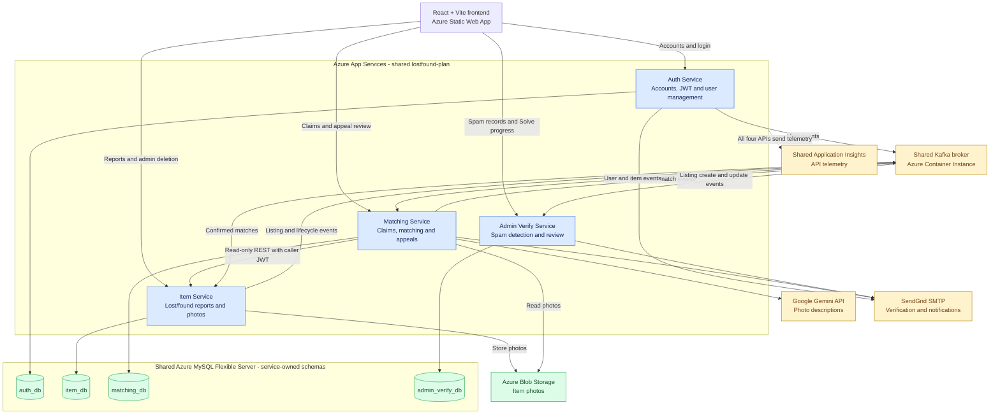
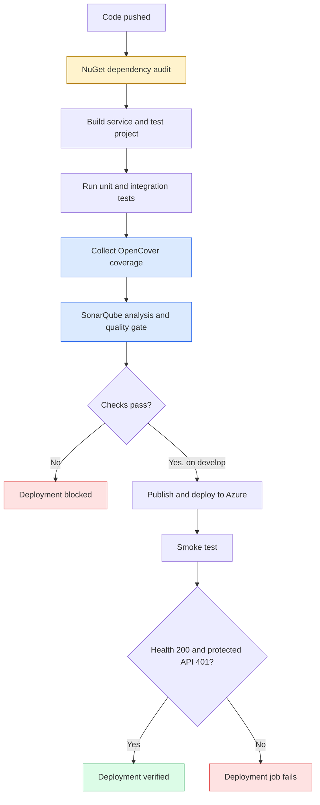
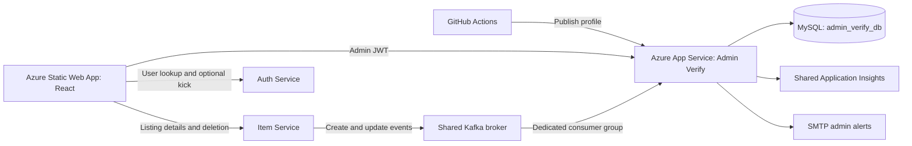

<div align="center">


# Back2U Lost & Found App

Helping people get lost belongings back, one confirmed match at a time

[🌐 Open the deployed application](https://kind-coast-0034d9700.5.azurestaticapps.net)

**Developed By**

[](https://github.com/IT24103447)
[](https://github.com/IT24103581)
[](https://github.com/it24103457)
[](https://github.com/WattBhanu)


</div>

---

Back2U is a web application that helps people get lost belongings back. People who lost something and people who found something both post reports in one place. Users can then find a report that looks like theirs, compare the two with a confidence score, and claim the match. Contact details are only shared once **both** owners confirm. Below-threshold pairs can be appealed to an administrator, and administrators can manage users and review suspicious posting bursts (spam).

The system is a set of **independent .NET 8 microservices**, one per domain, with a single **React** frontend. Services exchange state changes asynchronously over **Kafka**, and each owns its own **MySQL** schema. Everything is deployed on **Azure**.

**What users can do**
- Register, verify their email with a one-time code, sign in, edit their profile, reset their password and delete their account.
- Report a lost or found item with an optional photo, then edit, resolve or delete it; browse and filter everyone's active reports.
- Compare one of their reports with another user's report, see the score and its breakdown, and claim the match (score ≥ 60%) or appeal it (below 60%).
- Confirm or reject a claim made on their report, and see the other person's contact details once both sides confirm.

**What administrators can do**
- Search, kick and unkick users.
- Verify or reject match appeals.
- Review spam records created from posting bursts: open them, dismiss false positives, or solve them by deleting the listings and optionally kicking the user.

| Link | Address |
|---|---|
| Deployed application | [kind-coast-0034d9700.5.azurestaticapps.net](https://kind-coast-0034d9700.5.azurestaticapps.net) |
| API documentation (Swagger) | [Auth](https://lostfound-auth-service.azurewebsites.net/swagger) · [Item](https://lostfound-item-service-f9htesh2drbkd0dh.southeastasia-01.azurewebsites.net/swagger) · [Matching](https://lostfound-matching-service.azurewebsites.net/swagger) · [Admin Verify](https://lostfound-adminverify-service-b8fjfybzdkcrashd.southeastasia-01.azurewebsites.net/swagger) |
| CI/CD runs | [GitHub Actions](https://github.com/IT24103447/LostandFoundApp/actions) |
| Code quality (Admin Verify) | [SonarQube Cloud](https://sonarcloud.io/project/overview?id=it24103447_lostandfoundapp) |

## Contents

1. [Project status](#project-status)
2. [Architecture](#architecture)
3. [Auth Service](#auth-service-servicesauthservice)
4. [Item Service](#item-service-servicesitemservice)
5. [Matching Service](#matching-service-servicesmatchingservice)
6. [Admin Verify Service](#admin-verify-service-servicesadminverifyservice)
7. [Frontend](#frontend-frontend)
8. [Testing](#testing)
9. [Local development](#local-development)
10. [CI/CD](#cicd)
11. [Known limitations](#known-limitations)
12. [Documentation](#documentation)
13. [Team](#team)

## Project status

All four backend services and the frontend are built, tested and deployed to Azure.

| Component | Status | Scope |
|---|---|---|
| Auth Service | ✅ Built, tested, deployed | Registration, email OTP verification, login/JWT, password reset, profile update, account deletion, admin user management (list, lookup, kick, unkick) |
| Item Service | ✅ Built, tested, deployed | Lost/found reports with a photo, edit, search/filter, details, resolve, soft-delete, "my reports", admin listing read/delete; transactional outbox for `items.*` events; consumes `matches.confirmed` |
| Matching Service | ✅ Built, tested, deployed | AI photo descriptions (Gemini), claim preview and scoring, two-sided confirm/reject, contact hand-off, confirmed-match events, email notifications, match re-evaluation, match appeals |
| Admin Verify Service | ✅ Built, tested, deployed | Kafka listing intake, posting-burst (spam) detection, admin alerts, Spam Review, Open, Dismiss and resumable Solve; SonarQube, coverage, dependency audit and post-deployment smoke test |
| Frontend | ✅ Deployed | All user and admin screens, connected to all four deployed APIs |

## Architecture

Microservices, no API gateway: the frontend calls each service's own base URL directly. Cross-service *state changes and signals* go through a shared, self-hosted Kafka broker. Each service owns its own MySQL schema.



| Service | Responsibility | Database | Local port |
|---|---|---|---|
| **Auth** | Accounts, email verification, JWT authentication, profiles and user management | `auth_db` | 5261 |
| **Item** | Lost/found reports, search, photos and listing management | `item_db` | 5001 |
| **Matching** | AI-assisted matching, claims, confirmations, appeals and notifications | `matching_db` | 5179 |
| **Admin Verify** | Posting-burst detection, admin alerts and spam record review | `admin_verify_db` | 5019 |

**Authentication across services.** Auth Service authenticates users and issues JWTs. Every other service validates these tokens locally using the shared `Jwt:Secret`, `Jwt:Issuer` and `Jwt:Audience`, without calling Auth Service. The frontend sends `Authorization: Bearer <jwt>` with protected requests (and the `auth_token` cookie to Auth Service itself). Matching's claim operations require the `email_verified=1` claim through the `VerifiedClaimUser` policy. Admin-only operations enforce admin authorization in every service (`AdminOnly` policy).

**Synchronous reads between services.** When previewing or submitting a claim (or re-scoring an appeal), Matching Service reads reports from Item Service over REST using `GET /api/items/{lost|found}/{id}` and the `/mine` endpoints. It forwards the caller's JWT so Item Service applies its own authorization rules. These calls are read-only; Matching does not change reports through REST.

**Asynchronous events between services.** Kafka carries user changes, listing changes and confirmed-match events. Matching consumes user and item events to maintain notification contacts and matching information. Admin Verify consumes listing create/update events to detect posting bursts. Once a match is confirmed, Matching publishes `matches.confirmed`, which Item Service consumes to resolve both reports.

**Admin workflows across services.** The frontend coordinates actions that span services: during Solve it asks Item Service to delete the listings and Auth Service to perform the optional kick, and saves each result in Admin Verify so interrupted work can resume. Appeal verification happens inside Matching, which creates the match through its normal claim code.

**Hosting and shared resources.** All four APIs run on Azure App Service on the shared `lostfound-plan`. Azure Blob Storage holds item photos, Gemini generates photo descriptions, SendGrid SMTP delivers emails, and Application Insights collects API telemetry. Kafka runs in an Azure Container Instance.

### Kafka topics

Topic names are `{TopicPrefix}.{event}`; delivery is at-least-once, so consumers de-duplicate on `EventId`.

| Topic | Producer | Consumers | Purpose |
|---|---|---|---|
| `auth.user.verified` / `.profile_updated` / `.kicked` / `.unkicked` / `.deleted` | Auth | Matching (notification contacts, only when `Notifications:Enabled`) | Keep a local email/active/deleted copy of each user for notifications |
| `items.lost_item.created` / `.updated` | Item | Matching, Admin Verify | Image-description jobs and match re-evaluation; listing intake and spam detection |
| `items.found_item.created` / `.updated` | Item | Matching, Admin Verify | Same, for found reports |
| `items.lost_item.resolved` / `items.found_item.resolved` | Item | Matching | Deactivate matches on a resolved report |
| `items.item.delete_requested` | Item (owner or admin delete, lost *and* found) | Matching | Deactivate matches on a deleted report |
| `matches.confirmed` | Matching | Item | Both parties confirmed - Item Service marks both reports `RESOLVED` |

**Reliability patterns:**

- **Item Service - transactional outbox.** Controllers write the event to `outbox_events` in the same DB transaction as the item change; `OutboxRelayService` publishes to Kafka with retry/backoff and a short lease so several instances never double-publish.
- **Item Service - inbox.** `match_resolution_inbox` makes `matches.confirmed` handling idempotent; the Kafka offset is committed only after the DB transaction commits.
- **Matching Service - confirmation outbox.** `matches.confirmed` is written to `match_confirmation_outbox` in the same transaction as the match reaching `CONFIRMED`, then published by `MatchConfirmationPublisher`.
- **Admin Verify Service - transactional intake.** Each listing event is recorded in `processed_events`, tracked and run through the spam rule in one transaction; a failure rolls back and Kafka re-delivers the same event.
- **Email queues.** Matching (match and appeal emails) and Admin Verify (spam alerts) queue every email in a table and send it from a background worker with retries, so a decision is never lost because SMTP was briefly unavailable.

Item events carry `HiddenInformation` (the owner-only verification detail) for Matching's use. See [Known limitations](#known-limitations) for the broker-security caveat.

## Auth Service (`services/AuthService`)

.NET 8 Web API, raw ADO.NET (parameterized SQL, no ORM), MySQL `auth_db`, BCrypt password hashing, SMTP for verification and reset emails.

### How accounts work

1. **Register.** The account is created unverified (password hashed with BCrypt, work factor 12; email and phone number must be unique) and a **6-digit code** is emailed. Codes expire after **10 minutes** and are stored only as SHA-256 hashes.
2. **Verify.** The user enters the code (at most **10 attempts**; a new code can be requested after a **60-second** cooldown). On success the account is marked verified, `auth.user.verified` is published, and the user is signed in.
3. **Sign in.** A verified, active account receives a **JWT valid for 24 hours**, both in the response body and in an `HttpOnly` `auth_token` cookie. An unverified account is sent back through verification with a fresh code; a kicked or deleted account is refused (`403` "Your account has been suspended.").
4. **Manage the account.** Users update their name and phone (`auth.user.profile_updated` is published when a field actually changes), reset a forgotten password with an emailed code (which also signs them in), and delete their account (soft delete, `auth.user.deleted`).
5. **Administer users.** Admins list and search users, look up a user's contact details by id (used by the Match Appeals and Spam Review pages), and kick or unkick users (`auth.user.kicked` / `.unkicked`). A kicked user cannot sign in, and Matching stops emailing them.

The JWT carries the user id (`sub`), `email`, `name`, `phone_no`, `email_verified` and `is_admin` claims. The other services rely on these, for example Matching takes the claimant's contact details from them. Registration, verification, resend, login, forgot-password and reset-password are each rate-limited with a fixed window and return `429` when exceeded.

### API

| Method & route | Purpose |
|---|---|
| `POST /api/auth/register` | Create an unverified account and email a verification code |
| `POST /api/auth/verify-email` | Verify the code; signs the user in |
| `GET /api/auth/verification-status?sessionToken=` | Whether the account behind a verification session is verified |
| `POST /api/auth/resend-verification` | Send a new code, optionally to a corrected email address (cooldown applies) |
| `POST /api/auth/login` | Sign in; returns the JWT and sets the `auth_token` cookie |
| `POST /api/auth/logout` | Clear the `auth_token` cookie |
| `GET /api/auth/me` · `PUT /api/auth/me` · `DELETE /api/auth/me` | Read, update or delete the signed-in user's account |
| `POST /api/auth/forgot-password` · `POST /api/auth/reset-password` | Email a reset code; set a new password with it |
| `GET /api/admin/users` | Admin: list users (search, kicked/verified/deleted filters, paging) |
| `GET /api/admin/users/{id}` | Admin: a user's name, email and phone |
| `POST /api/admin/users/{id}/kick` · `/unkick` | Admin: suspend or restore a user |

Admin routes use the `AdminOnly` policy, which checks the caller is an admin **in the database** and is not kicked or deleted. Non-admins get `403`; unauthenticated calls get `401`.

**Data model** (`auth_db`, migrations `V001`-`V007`): `users` (with `is_admin`, `is_email_verified`, `is_kicked` and soft-delete `deleted_at`), `email_verification_tokens` and `password_reset_tokens` (hashed code, expiry, attempt counter).

**Development seed.** In Development only, Auth seeds admin and user accounts (for example `admin1@lostandfound.com`) used by the local Selenium and JMeter suites. Azure has no seeded accounts.

## Item Service (`services/ItemService`)

.NET 8 Web API, raw ADO.NET (parameterized SQL, no ORM), MySQL `item_db`, Azure Blob Storage for photos.

### How reports work

1. **Report.** A signed-in user reports a **lost** item (title, category, description, date lost, last known location) or a **found** item (the same, with date and location found). Both need **private verification information**: a detail only the real owner would know, which is never shown on public pages. The date cannot be in the future, blank or whitespace-only fields are rejected, and the category must be one of the supported list. One optional photo can be attached (JPEG, PNG or WEBP, up to 5 MB). Its file signature is checked, not just the declared type, and it is stored in Blob Storage. The report starts **Active**, and `items.{lost|found}_item.created` is published through the outbox.
2. **Browse and search.** Anyone signed in can browse active reports and narrow them by keyword, category, type (lost or found) and date range, page by page. The details page shows everything except the private verification information. A resolved report is visible only to its own reporter.
3. **Manage own reports.** "My reports" lists the caller's lost and found reports. The reporter can edit the details and replace or remove the photo (each publishes `.updated`, which makes Matching re-check photo descriptions and existing matches), mark the report **Resolved** (`.resolved`, which deactivates its matches), or delete it (a soft delete that publishes `items.item.delete_requested`). Only the reporter can change a report.
4. **Matched and resolved.** When Matching publishes `matches.confirmed`, Item Service marks **both** reports Resolved (the inbox makes this idempotent).
5. **Admin access.** Admins can read any listing (including resolved and deleted ones) and its photos, and soft-delete an active listing. Spam Review uses this to show listings and to delete them during Solve. An admin delete publishes the same `items.item.delete_requested` event as an owner delete.

**Data model.** `lost_items`, `lost_item_photos`, `found_items`, `found_item_photos` (soft-delete via `deleted_at`), plus `outbox_events` and `match_resolution_inbox`. Statuses: `ACTIVE`, `MATCHED`, `CLOSED`, `RESOLVED`. Categories: Electronics, Bags, Clothing, Accessories, Documents, Keys, Other (mirrored in the frontend's `reportLostItemSchema.ts`).

**API** (all `[Authorize]`; the reporter's id comes from the JWT `sub` claim):

| Method & route | Purpose |
|---|---|
| `GET /api/items` | Browse/search active items - `q`, `category`, `type` (LOST/FOUND), `dateFrom`, `dateTo`, `page`, `pageSize` (1-50) |
| `GET /api/items/{id}` | Public item details (never includes `HiddenInformation`); resolved items are visible only to their reporter |
| `POST /api/items/lost` · `POST /api/items/found` | Report an item (multipart form, optional single photo: JPEG/PNG/WEBP, ≤ 5 MB, file-signature checked) |
| `GET /api/items/{lost\|found}/{id}` | Report details |
| `PUT /api/items/{lost\|found}/{id}` | Edit own report |
| `PUT` / `DELETE /api/items/{lost\|found}/{id}/photo` | Replace / remove the photo |
| `POST /api/items/{lost\|found}/{id}/resolve` | Mark resolved (reporter only; `409` unless `ACTIVE`) |
| `DELETE /api/items/{lost\|found}/{id}` | Soft-delete (reporter only; `409` if `MATCHED`) |
| `GET /api/items/{lost\|found}/mine` | The caller's own reports |
| `GET /api/admin/items/{lost\|found}/{id}` | Admin: read any listing, including resolved and soft-deleted ones |
| `GET /api/admin/items/{lost\|found}/{id}/photos` | Admin: a listing's photo URLs (used by the Spam Review popup) |
| `DELETE /api/admin/items/{lost\|found}/{id}` | Admin: soft-delete an active listing (`409` otherwise); publishes `items.item.delete_requested` like an owner delete |

Non-reporters get `403`, unknown/soft-deleted ids get `404`, unauthenticated calls get `401`. Item Service has no users table, so its `AdminOnly` policy checks the JWT's `is_admin` claim.

**Storage guard.** In Production the service refuses to start without `BlobStorage:ConnectionString` rather than falling back to local disk. In Development it falls back to `wwwroot/photos`.

## Matching Service (`services/MatchingService`)

.NET 8 Web API, raw ADO.NET, MySQL `matching_db`, Google Gemini for image descriptions, SMTP for email.

### How a match works

1. **Describe photos.** On `items.*.created/updated` events, an `image_descriptions` job (lease + retry/backoff, max 5 attempts) asks Gemini for a structured description of the item photo (object type, colours, materials, brand, patterns, condition, distinctive features). The prompt treats text inside the image as untrusted and forbids reproducing personal data. Gated by `ImageProcessing:Enabled`.
2. **Preview.** A verified user who owns *one* of the two reports (and not both) previews a lost/found pair. The score (`text-v1`) is a weighted word-overlap similarity: title 20, category 15, description 20, and - when both reports have photos - image description 30 and image attributes 15, normalised by the weights in use. **Threshold: 60.** The response includes the breakdown and a `previewVersion` hash.
3. **Claim.** Submitting requires that `previewVersion` to still match (otherwise `409` - preview again), a score ≥ 60 (`422` otherwise), both reports `ACTIVE`, and that neither report already has a confirmed match. The match starts as `LOST_REPORTER_CONFIRMED` or `FINDER_CONFIRMED` depending on who claimed; the claimant's contact details are captured from their JWT.
4. **Counterpart decides.** The other party confirms or rejects (`CONFIRMED` / `REJECTED`); every decision is written to `match_actions` for audit.
5. **Confirmed.** Both parties can fetch each other's contact details (`return-contact`, confirmed + active matches only). `matches.confirmed` is published through the outbox and Item Service resolves both reports.
6. **Keep matches honest.** Edited reports are re-scored by a `match_reevaluation_jobs` worker (matches that no longer qualify are deactivated, and the job waits for pending photo descriptions); resolved or deleted reports deactivate their matches via `matching_item_states`.
7. **Notify.** Email notifications (`COUNTERPART_ACTION`, `MATCH_CONFIRMED`, `MATCH_REJECTED`) are queued in `match_notifications` and sent by a worker with retry; recipient emails come from `notification_contacts`, kept current by the `auth.user.*` events. Gated by `Notifications:Enabled`.

### How an appeal works

1. **Send.** For a pair scoring **below 60%**, either owner can send an appeal instead of a claim, with an optional note (300 characters). The same checks as a claim apply (own report, both active, not already matched, verified email). The appeal stores a snapshot of both reports, the score and its breakdown, the appellant's role and their contact details from the JWT, and is **Pending**. No match is created and nobody is notified.
2. **One per pair.** A unique key allows one appeal per lost/found pair, whoever sends it; the other owner sees "Appeal unavailable", and a duplicate returns `409`. Editing a report in a Pending appeal (or in a Verified appeal whose match is still waiting) shows a warning that the edit may cancel the match.
3. **Admin review.** Admins list appeals by status (Pending, Verified, Rejected). Opening a Pending appeal re-reads both reports from Item Service and shows the **current** score next to the saved one.
4. **Verify.** The appeal is marked Verified first, then a normal match is created through the existing claim code with the appellant's side already confirmed, so the other owner sees it under "waiting on you". If creating the match fails, the appeal goes back to Pending. The frontend re-checks both users still exist before verifying.
5. **Reject.** The appeal becomes Rejected with an optional reason (300 characters) shown to the appellant.
6. **Emails.** The decision and its email (`appeal_notifications`) are saved in one transaction. A Verified email is sent once the match exists; a Rejected email includes the reason. Admins are not emailed about appeals; they work from the Pending queue.

Two admins deciding the same appeal at once: only a Pending appeal can be decided, so the second gets `409`.

**API** (all require a verified-email JWT; admin routes require `AdminOnly`):

| Method & route | Purpose |
|---|---|
| `GET /api/matches/candidates?type=LOST\|FOUND` | The caller's own active reports that can be put forward |
| `POST /api/matches/preview` | Score a lost/found pair |
| `POST /api/matches/claim` | Submit a claim (`201`) |
| `GET /api/matches/mine` | Matches the caller is part of |
| `GET /api/matches?section=…&page=&size=` | Paged list; sections: `active`, `waiting-on-you`, `waiting-on-other`, `confirmed`, `rejected`, `deactivated`, `closed`, `all` |
| `GET /api/matches/{matchId}` | Match details (participants only) |
| `POST /api/matches/{matchId}/finder/confirm` · `/reject` · `GET …/return-contact` | Finder's decision / contact (when the lost reporter claimed first) |
| `POST /api/matches/{matchId}/lost-reporter/confirm` · `/reject` · `GET …/return-contact` | Lost reporter's decision / contact (when the finder claimed first) |
| `POST /api/matches/appeals` | Send an appeal for a below-threshold pair (`201`) |
| `GET /api/matches/appeals/mine` | The caller's own appeals, newest first |
| `GET /api/matches/appeals/pair-status` · `/edit-warning` | Whether a pair is already appealed; whether editing a report should warn |
| `GET /api/admin/match-appeals?status=` · `GET /api/admin/match-appeals/{id}` | Admin: list appeals by status; open one (re-scores Pending appeals) |
| `POST /api/admin/match-appeals/{id}/verify` · `/reject` | Admin: verify (creates the match) or reject with an optional reason |
| `GET /health` | Liveness only |

**Data model** (`matching_db`, migrations `001`-`015`): `image_descriptions`, `matches`, `match_actions`, `match_confirmation_outbox`, `notification_contacts`, `match_notifications`, `match_notification_activation`, `matching_item_states`, `matching_item_lifecycle_events`, `matching_item_snapshots`, `match_reevaluation_jobs`, `match_appeals` and `appeal_notifications`.

## Admin Verify Service (`services/AdminVerifyService`)

.NET 8 Web API, raw ADO.NET, MySQL `admin_verify_db`, Kafka consumer for listing events, SMTP for admin alerts. It stores **only IDs and times** for listings; titles, descriptions and personal details are never stored or logged, and are read live from Item and Auth when an admin needs them.

### How spam detection works

1. **Intake.** The service consumes `items.lost_item.created`, `items.found_item.created`, `items.lost_item.updated` and `items.found_item.updated`. Each event's id goes into `processed_events` first, so a re-delivered event is ignored. A new listing is added to `tracked_listings`; edits to an already-tracked listing do not count as a new post.
2. **Look-back.** For each new listing, the rule counts the user's **free** listings (not already in any spam record, of any status) posted from **60 minutes before this listing up to it**, both ends included. Lost and found listings count together.
3. **Create a record.** At **3 or more**, a **Needs review** spam record is created with those listings. Its score is the number of listings. One alert email per address in `spam_alert_recipients` is queued in the same transaction; the flagged user is never emailed.
4. **Collect.** For the next **60 minutes** after the listing that created it, the user's new listings **join** that record while it is still Needs review and below the optional cap. Collecting stops when that time passes, when an admin opens the record, or when the cap is reached. After that, a new record needs 3 new free listings within 60 minutes. A listing can belong to only one record, ever.
5. **Concurrency.** The user's collecting record is locked and unique keys allow one collecting record per user and one record per listing. If two transactions still clash, one rolls back and Kafka re-delivers its event, which then joins the existing record.

The threshold, window and cap are settings (`Detection:SpamThreshold`, `Detection:SpamWindowMinutes`, `Detection:SpamRecordCap`, default `3` / `60` / `0` = no cap), read for every listing so a change applies to the next one.

### How a spam record is reviewed

```
NEEDS_REVIEW ──open──► UNDER_REVIEW ──dismiss──► DISMISSED
 (collecting)        (collecting stops)
                          └──solve──► PENDING_SOLVE ──finish──► SOLVED
                                      (resumable)
```

- **Spam Review list.** Tabs Active (Needs review, Under review, Pending solve), Dismissed and Solved; sort by score or date flagged; filter by flagged user (name or email, through Auth) and date range; 20 records per page with scroll loading. The flagged user's name, email and phone are read live from Auth ("Deleted user" if the account is gone).
- **Open.** A Needs review record shows a warning first, then becomes **Under review** and stops collecting. Under review and Pending solve records open straight away; Dismissed and Solved records open read-only. The popup shows each listing's live state and photos from Item Service and refreshes every 3 seconds, so a record closed by another admin turns read-only.
- **Dismiss** (from Under review only). Marks the record as a false positive. The listings are left unchanged, stay in the record and are never counted again.
- **Solve** (from Under review, with an optional **Kick user**). The record becomes **Pending solve** and the kick choice is saved. The frontend deletes each active listing through Item Service (up to 5 tries, 1 second apart; listings already resolved, deleted or missing are **skipped**) and saves each result in Admin Verify as it goes. The kick is attempted **once**, after the listings, through Auth Service. **Finish** marks the record **Solved** only when every listing is deleted or skipped and the kick (if chosen) has been attempted. If anything fails, the record stays Pending solve and any admin can **Resume Solve**, continuing from the saved results.
- **Two admins at once.** Every action is one atomic update from the expected status, so one admin succeeds and the other gets `409` "already being handled".

### API

All routes require an admin JWT (`AdminOnly` policy); the token is read from the `Authorization` header or the `auth_token` cookie.

| Method & route | Purpose |
|---|---|
| `GET /api/admin/spam-records?tab=&sort=&from=&to=&userIds=&page=` | Spam Review list (20 per page, `hasMore` for scroll loading) |
| `GET /api/admin/spam-records/{id}` | Record detail with its listings and saved Solve results (read-only) |
| `POST /api/admin/spam-records/{id}/open` | Open: Needs review → Under review; returns the detail |
| `POST /api/admin/spam-records/{id}/dismiss` | Dismiss an Under review record |
| `POST /api/admin/spam-records/{id}/solve` | Start (`resume: false`, with `kick`) or resume (`resume: true`) a Solve |
| `PUT /api/admin/spam-records/{id}/listings/{listingId}/result` | Save one listing's Solve result (`DELETED`, `SKIPPED` or `FAILED`; a deleted result is never downgraded) |
| `PUT /api/admin/spam-records/{id}/kick-result` | Save the single kick attempt (`KICKED` or `FAILED`) |
| `POST /api/admin/spam-records/{id}/finish` | Pending solve → Solved, once every listing and the kick are done |
| `GET /health` | Liveness only |

The database tables and migrations are listed in the DevOps record below ([Database migrations applied](#database-migrations-applied)).

### DevOps record: pipeline, quality gates and deployment

**✅ Built, tested and deployed to Azure.** DevOps work covered pipeline automation, quality/security checks, configuration, database migrations and deployment verification.

| Detail | Value |
|---|---|
| Source / tests | [`services/AdminVerifyService`](services/AdminVerifyService) / [`services/AdminVerifyService.Tests`](services/AdminVerifyService.Tests) |
| Runtime / database | .NET 8 Web API / MySQL `admin_verify_db` |
| Detection default | **3 listings within 60 minutes**; record cap disabled |
| Access | Admin-only JWT authorization |
| Local API / Swagger | `http://localhost:5019` / `http://localhost:5019/swagger` |
| Azure API | [Deployed Admin Verify Service](https://lostfound-adminverify-service-b8fjfybzdkcrashd.southeastasia-01.azurewebsites.net) |
| Health / API documentation | `/health` / `/swagger` (local and Azure) |

#### Main DevOps additions

| Addition | What it does | Deployment effect |
|---|---|---|
| **1. SonarQube + test coverage** | Reviews code quality and reports automated-test coverage | A failed quality gate blocks deployment |
| **2. NuGet dependency auditing** | Checks direct and transitive service dependencies for high/critical vulnerabilities | A failed audit blocks deployment |
| **3. Post-deployment smoke test** | Checks application health and protected API access after deployment | Failed checks fail the deployment job |



##### 1. SonarQube analysis and coverage

| Item | Implementation |
|---|---|
| Platform | [SonarQube Cloud project](https://sonarcloud.io/project/overview?id=it24103447_lostandfoundapp) |
| Tools / authentication | SonarScanner for .NET, Java 21 / GitHub `SONAR_TOKEN` |
| Test scope | Full Admin Verify test project, including unit, API, MySQL and Kafka scenarios |
| Coverage | OpenCover report submitted to SonarQube |
| Analysis scope | Test projects excluded from source-quality analysis |
| Deployment gate | Wait for the SonarQube quality gate before deployment |

**Recorded SonarQube screenshot results:**

| Metric | Result |
|---|---|
| Analyzed branch | `feature/Admin-Verify-Service` |
| Commit shown | `c87d8669` |
| Quality gate | **✅ Passed** |
| Coverage on new code | **91.16%** |
| New issues / accepted issues | **0 / 15** |
| Duplication on new code | **0.0%** |
| Security hotspots | **0** |
| Analysis warning | **1**; details were not included in the supplied screenshot |

Coverage above applies to **new code on the feature branch**, not overall project coverage or a deployment-branch measurement. The screenshot shows no coverage condition configured: coverage is reported, but a minimum coverage percentage is not documented as a deployment requirement.

**27 unique findings were reviewed** across the analysis runs, including the final scan after Open, Dismiss and Solve. Repeated findings across analysis runs were counted once.

| Review decision | Count | Action / reason |
|---|---:|---|
| Fixed by developer | **6** | Authorization registration, two shutdown-cancellation comments, the `Program` constructor and the two required Solve request fields |
| False positives | **6** | Event properties needed for JSON deserialization |
| Accepted with reasons | **15** | Repository consistency, restricted logging, method parameters and existing implementation choices |
| **Total** | **27** | Every finding assigned a review decision |

| Fixed finding | Developer change |
|---|---|
| Older authorization registration | Used `AddAuthorizationBuilder()` while retaining `AdminOnly` |
| Empty cancellation handler in `ListingEventConsumer` | Explained expected shutdown cancellation |
| Empty cancellation handler in `SpamAlertWorker` | Added the same shutdown explanation |
| Partial `Program` constructor | Added a protected constructor while retaining integration-test support |
| Solve request `Kick` and `Resume` could be under-posted (2 findings) | Marked both `[JsonRequired]`, so a request missing either field returns `400` instead of being read as `false` |

The six false positives concerned `EventId`, `UserId`, `LostItemId`, `FoundItemId`, `CreatedAt` and `UpdatedAt`. DevOps integrated the analysis and documented the review decisions; the developer made the code fixes.

##### 2. NuGet dependency security check

| Setting | Value | Purpose |
|---|---|---|
| `NuGetAudit` | `true` | Enable auditing during service restore |
| `NuGetAuditMode` | `all` | Include direct and transitive dependencies |
| `NuGetAuditLevel` | `high` | Check high and critical vulnerabilities |
| `WarningsAsErrors` | `NU1900;NU1903;NU1904` | Fail validation for audit failures and high/critical vulnerability warnings |

**If the audit fails, deployment cannot continue.** Successful audit steps are linked in the deployment evidence below.

##### 3. Post-deployment smoke test

| Request | Expected response | What it checks |
|---|---|---|
| `GET /health` | **200 OK** | Application is responding |
| `GET /api/admin/spam-records` without credentials | **401 Unauthorized** | Protected endpoint rejects unauthenticated access |

| Retry setting | Value |
|---|---:|
| Maximum attempts | 18 |
| Timeout per request | 8 seconds |
| Delay between unsuccessful attempts | 10 seconds |
| Overall step timeout | 5 minutes |

**Both checks must pass.** Otherwise, the deployment job fails. These checks verify liveness and unauthenticated access rejection; functional flows were checked separately.

#### CI/CD workflow and verified evidence

| Detail | Configuration |
|---|---|
| Workflow | [admin-verify-service-ci-cd.yml](.github/workflows/admin-verify-service-ci-cd.yml) |
| Run history | [GitHub Actions](https://github.com/IT24103447/LostandFoundApp/actions/workflows/admin-verify-service-ci-cd.yml) |
| Trigger | Push to `feature/**`, `develop` or `main` |
| Path filters | `services/AdminVerifyService/**`, `services/AdminVerifyService.Tests/**`, and the workflow file |
| Jobs | `build-and-test` → `deploy`, using `needs: build-and-test` |

| Branch | Build, tests, audit and analysis | Deploy |
|---|---|---|
| `feature/**` | ✅ | — |
| `develop` | ✅ | ✅ After checks pass |
| `main` | ✅ | — |

The following job and step results were verified through GitHub. Each run's latest attempt completed successfully.

| Run | NuGet audit | Tests + coverage collection | SonarQube gate | Azure deployment | Smoke test |
|---|---|---|---|---|---|
| [37585675560](https://github.com/IT24103447/LostandFoundApp/actions/runs/37585675560) | ✅ | ✅ | ✅ | ✅ | Not included |
| [38039755618](https://github.com/IT24103447/LostandFoundApp/actions/runs/38039755618) | ✅ | ✅ | ✅ | ✅ | ✅ |
| [38464960214](https://github.com/IT24103447/LostandFoundApp/actions/runs/38464960214) | ✅ | ✅ | ✅ | ✅ | ✅ |
| [38618752772](https://github.com/IT24103447/LostandFoundApp/actions/runs/38618752772) | ✅ | ✅ | ✅ | ✅ | ✅ |

Selenium and JMeter tests are maintained separately by QA and are not run by this workflow.

#### Sprint 4 deployment topology



| Azure resource | Configuration |
|---|---|
| Resource group / region | `lostfound-rg` / Southeast Asia |
| App Service | `lostfound-adminverify-service` |
| Publishing model / runtime | Code / Linux, .NET 8 |
| Plan / instances | `lostfound-plan`, Free F1 / one instance |
| Shared resources | MySQL server, Kafka broker, Application Insights and existing frontend hosting |

| Reported rollout | Work included | Result recorded in Sprint 4 report |
|---|---|---|
| Initial rollout | Deployment baseline and CI/CD quality checks | Deployed |
| Detection and review | Listing intake, spam detection, review, smoke test and frontend API URL | Deployed and verified |
| Final workflow | Open, Dismiss, Solve, final database changes and Swagger | Completed and verified |

The report groups the work into three rollouts; the evidence table above contains four successful workflow runs and does not assign each run to a particular rollout.

#### Configuration and secrets

| Location | Stored information |
|---|---|
| GitHub Secrets | `AZURE_ADMIN_VERIFY_SERVICE_PUBLISH_PROFILE`, `SONAR_TOKEN` |
| Azure application settings | Production connection strings, JWT, CORS, Kafka and SMTP settings |
| .NET user-secrets | Local development secrets |

| Azure setting | Value / purpose |
|---|---|
| `ConnectionStrings__MySql` | Connection to `admin_verify_db` |
| `Jwt__Secret`, `Jwt__Issuer`, `Jwt__Audience` | Match Auth Service |
| `Cors__AllowedOrigins__0` | Deployed frontend origin |
| `Kafka__BootstrapServers` | Shared broker address |
| `Kafka__GroupId` / `Kafka__TopicPrefix` | `admin-verify-service` / `items` |
| `Detection__SpamThreshold` / `Detection__SpamWindowMinutes` | `3` / `60` |
| `Detection__SpamRecordCap` | `0` — disabled |
| `Notifications__Enabled` | Enable after configuring SMTP and recipients |
| `Smtp__Host`, `Smtp__Port`, `Smtp__User`, `Smtp__Password` | SMTP connection and credentials |
| `Smtp__FromAddress`, `Smtp__FromName` | Alert sender |
| `Frontend__BaseUrl` | Frontend address used in Spam Review links |
| `ApplicationInsights__ConnectionString` | Shared Application Insights connection |

Admin alert recipients are stored in `spam_alert_recipients`.

| Frontend build setting | Local | Azure |
|---|---|---|
| `VITE_ADMIN_API_BASE_URL` | `http://localhost:5019` | Deployed Admin Verify service URL |

**Rebuild the frontend after changing its API URL.** Vite includes the value at build time. Sprint 4 replaced the deployed frontend's earlier `localhost:5003` placeholder with the Azure API address.

#### Database migrations applied

**Apply production migrations before deploying dependent features.** Automatic migrations run only in Development.

| Admin Verify migration | Database change | Purpose |
|---|---|---|
| `001` | Create `tracked_listings` | Listing IDs, types, users and posting times |
| `002` | Create `processed_events` | Duplicate-event protection |
| `003` | Create `spam_records` | Spam records and review status |
| `004` | Create `spam_record_listings` | Listings attached to each record |
| `005` | Create `spam_alert_recipients` | Admin email recipients |
| `006` | Create `spam_record_notifications` | Alert jobs and delivery progress |
| `007` | Add `kick_status` to `spam_records` | Optional kick result |

**Seven migrations produce six application tables.** The earlier `record_actions` table is not part of the final design. The kick-status migration was renamed from `008` to `007`; the existing column was checked so the same change was applied only once.

| Kick status | Meaning |
|---|---|
| `NOT_REQUESTED` | No kick requested; default for existing records |
| `PENDING` | Waiting for the kick result |
| `KICKED` | Kick succeeded |
| `FAILED` | Kick failed |

| Matching migration | Change applied to `matching_db` |
|---|---|
| `012` | Create `match_appeals` |
| `013` | Create `matching_item_hidden_information` |
| `014` | Add appeal `rejection_reason` |
| `015` | Create `appeal_notifications` |

No additional Auth, Item or Matching migrations were required for the final Open, Dismiss and Solve rollout.

#### Kafka configuration and verification

| Setting | Value |
|---|---|
| Consumer group / topic prefix | `admin-verify-service` / `items` |
| Subscriptions | `items.lost_item.created`, `items.found_item.created`, `items.lost_item.updated`, `items.found_item.updated` |
| Duplicate handling | De-duplicate by `EventId`; edits to tracked listings do not count as new posts |
| First event is an update | Use the updated time for that listing |
| Failure handling | Event tracking, listing tracking and detection share a transaction; failures roll back and can retry |
| Stored data | Detection metadata; listing titles and descriptions are not stored by intake |
| Intake exclusions | Resolved and deleted events are not subscribed to |

| Topic | Recorded consumer offset | Recorded log-end offset | Lag |
|---|---:|---:|---:|
| `items.lost_item.created` | 286 | 286 | **0** |
| `items.found_item.created` | 268 | 268 | **0** |
| `items.found_item.updated` | 8 | 8 | **0** |
| `items.lost_item.updated` | 14 | 14 | **0** |

These are the inspected partition results recorded in the Sprint 4 report, not live broker measurements.

#### Deployment verification record

| Story | Flow checked in the deployed application | Reported result |
|---|---|---|
| LF-79 | Admin listing access, guarded deletion, user lookup and access restrictions | ✅ Verified |
| LF-80 | Listing intake, edits and duplicate handling | ✅ Verified |
| LF-81 | Below-60% appeals, Pending status, My Appeals and privacy | ✅ Verified |
| LF-82 | Posting-burst detection, additional listings and admin alerts | ✅ Verified |
| LF-87 | Spam tabs, user details, sorting, filtering and loading more records | ✅ Verified |
| LF-267 | Open warning, Under review, stopped collection and listing/photo details | ✅ Verified |
| LF-268 | Dismissed status, unchanged listings and no recounting | ✅ Verified |
| LF-269 | Deletion/skips, optional kick, saved progress, resume and match deactivation | ✅ Verified |
| LF-338 | Appeal approval creating a normal match and rejection with a reason | ✅ Verified |

Appeals belong to Matching Service. The frontend coordinates Item deletions and Auth kicks, while Admin Verify stores review/Solve progress.

#### Local Admin Verify setup

Requires .NET 8, MySQL and the shared Kafka broker. From the repository root, start Kafka:

```bash
cd infra/kafka
docker compose up -d
```

In another terminal, from the repository root:

```bash
cd services/AdminVerifyService
dotnet user-secrets set "ConnectionStrings:MySql" "Server=localhost;Database=admin_verify_db;Uid=root;Pwd=<password>;Allow User Variables=true;"
dotnet user-secrets set "Jwt:Secret" "<same value as Auth Service>"
dotnet user-secrets set "Jwt:Issuer" "auth-service"
dotnet user-secrets set "Jwt:Audience" "lostandfound-app"
dotnet run --launch-profile http
```

JWT settings must match Auth Service. Set `VITE_ADMIN_API_BASE_URL=http://localhost:5019` in `frontend/.env.local`. Kafka defaults to `localhost:9092`; email alerts are off until SMTP and recipients are configured.

Run the tests from the repository root with Docker running:

```bash
dotnet test services/AdminVerifyService.Tests
```

#### Operational notes and ownership

| Area | Current arrangement |
|---|---|
| Monitoring | Service registers Application Insights telemetry; `/health` provides liveness and the pipeline checks it after deployment |
| Reliability | Transactional intake, duplicate protection, notification job tracking and resumable Solve progress |
| Capacity | Free F1 with one instance; horizontal scaling and high availability are not demonstrated |
| Broker | Shared Kafka must be running; existing broker security/availability limits are listed in [Known limitations](#known-limitations) |
| Schema updates | Manual production migrations remain a deployment prerequisite |

| Role | Contribution |
|---|---|
| Developer | Implemented service features and the six code-quality fixes |
| QA | Created tests and maintained Selenium/JMeter checks |
| DevOps | Integrated build/tests/coverage, quality and security gates, deployment, configuration, migrations and live verification |

AI assistance supported pipeline review, configuration, dependency auditing, smoke-test design and deployment planning. Functional verification and rollout summaries come from the Sprint 4 DevOps report; pipeline step results come from the linked GitHub runs; feature-branch coverage comes from the supplied SonarQube screenshot.

## Frontend (`frontend/`)

React + Vite + TypeScript SPA (Tailwind CSS, React Router, React Hook Form + Zod). It calls each backend service directly over REST, with no API gateway, and is deployed to Azure Static Web Apps.

### Pages by feature

| Feature folder | Routes |
|---|---|
| `features/auth` | `/login`, `/register`, `/verify-email`, `/forgot-password`, `/reset-password`, `/profile` |
| `features/home` | `/` (browse/search) |
| `features/items` | `/report-lost-item`, `/report-found-item` (+ `/success`), `/my-reports`, `/edit-lost-item/:id`, `/edit-found-item/:id`, `/items/:id` (details + claim and appeal dialog) |
| `features/matches` | `/matched-items` (Matches and My appeals tabs), `/matched-items/:matchId` (review, confirm/reject, return contact) |
| `features/admin` | `/admin/users` (User Management), `/admin/match-appeals`, `/admin/spam-review`, `/admin/profile` |

Admin pages sit behind a route guard that only admins pass; the services enforce the same rule on every request.

### Folder conventions (multi-team)

Each microservice owns one folder under `frontend/src/features/<service>/` with this internal layout:

```
features/<service>/
├── api/         - HTTP wrappers that use ../../../lib/apiClient
├── schemas/     - zod schemas mirroring the backend DTOs
├── components/  - feature-specific UI (own UI primitives; only promote to a shared location when ≥2 features use them)
└── pages/       - route targets
```

- Add a new microservice's base URL to `frontend/src/config/env.ts` (and `.env.example`) - typed service map.
- Do not import from other `features/`. Cross-feature code lives in exactly two places: `lib/apiClient.ts` (HTTP primitive) and `App.tsx` (route table).
- New pages register a route by adding a single line to `App.tsx`; nothing else needs touching.
- `apiClient` sends cookies to Auth Service and `Authorization: Bearer <jwt>` to every other service; `AuthContext` holds the token in memory (Auth Service returns it in login/verify/reset/`me` response bodies).

### Run locally

```bash
cd frontend
npm ci
cp .env.example .env.local   # then edit if your service URLs differ
npm run dev                   # → http://localhost:5173
```

Local service URLs (from `.env.example` and each service's `launchSettings.json`): Item `http://localhost:5001`, Matching `http://localhost:5179` and Admin Verify `http://localhost:5019`. `VITE_AUTH_API_BASE_URL` is left **empty** locally: the Vite dev server proxies `/api/auth` and `/api/admin` to Auth Service on `http://localhost:5261`, so Auth's cookie stays same-origin. In production every `VITE_*_API_BASE_URL`, including Auth's, is set to the service's full Azure URL. Vite bakes these values in at build time, so the deployed frontend must be rebuilt after a service URL changes.

## Testing

Tests were written from each story's acceptance criteria, covering successful, negative and boundary cases, ownership and admin access, duplicates, state changes and concurrent operations.

| Level | Tools | What it covers |
|---|---|---|
| **Unit** | xUnit, Moq | Validators, scoring, parsers, controller/service logic and workers with dependencies mocked. Fast, no external services. |
| **Integration** | xUnit, `WebApplicationFactory<Program>`, Testcontainers | The real app against a disposable MySQL container; Item, Matching and Admin Verify also start a Kafka container for producer/consumer and outbox paths (**Docker must be running**). SMTP and Gemini are faked, except an optional Mailtrap-backed notification test. |
| **System / E2E** | Selenium (Chrome) | User journeys through the running frontend and services (see below) |
| **Performance** | Apache JMeter | Load, race and error-response checks per service (see below) |
| **Smoke** | `curl` in the Admin Verify workflow | The deployed service is healthy and rejects unauthenticated access |

**Backend test projects:**

```bash
dotnet test services/AuthService.Tests
dotnet test services/ItemService.Tests            # Docker required
dotnet test services/MatchingService.Tests        # Docker required
dotnet test services/AdminVerifyService.Tests     # Docker required
```

Item Service's per-story `--filter` commands are in `services/ItemService.Tests/README.md`.

**Recorded coverage:**

| Service | Line | Branch |
|---|---:|---:|
| Auth | 78.2% | 63.9% |
| Item | 81.1% | 76.7% |
| Matching (lines include the Item confirmation subset) | 85.85% | 79.0% |
| Admin Verify | 90.8% | 92.2% |

**Selenium suites** (`tests/e2e/`) need the frontend and the relevant services running locally. See the `README.md` in a suite for its `SELENIUM_*` variables, and never commit real passwords.

| Service | Suites |
|---|---|
| Auth | `LoginForm`, `RegisterForm`, `VerifyEmailForm`, `ResetPasswordForm`, `ProfileForm`, `DeleteAccountForm`, `Adminusermanagement` |
| Item | `ReportLostItemForm` (report lost/found, edit, search/filter, resolve, details, delete, my reports) |
| Matching | `ClaimAndMatch` (claim-and-match flow, matched-items page, appeals), `AdminMatchAppeals` |
| Admin Verify | `AdminSpamReview` (Spam Review list and record Open/Dismiss/Solve flows) |

**JMeter plans** (`tests/performance/`):

| Folder | Plans |
|---|---|
| Root | Auth registration load and admin user-lookup load |
| `ItemService/` | Create, update/search, resolve/details, delete/my-reports and admin read/delete load |
| `MatchingService/` | Photo creation, claim preview, duplicate-claim race, match listing, decision/confirm load and races, deactivated-match listing, appeal send and duplicate race, admin appeal list and decision race |
| `AdminVerifyService/` | `16` spam burst through the real Item → Kafka → Admin Verify pipeline, `17` Spam Review list load, `18` Open/Dismiss/Solve case actions (seeded by `18-seed-case-action-records.sql`) |

Selenium and JMeter are run by QA against a running system; the CI workflows run the xUnit projects.

## Local development

Install the .NET 8 SDK, Node.js and npm, MySQL and Docker. Start local Kafka once for all services from the repository root:

```bash
cd infra/kafka
docker compose up -d     # localhost:9092
```

Configuration is applied in this precedence (later overrides earlier): `appsettings.json` → `appsettings.Development.json` → user-secrets (dev) → environment variables (CI / Azure).

Development runs apply each service's SQL migrations automatically (`DbInitializer`). **Azure does not**: production migrations are applied manually before deploying code that depends on them (see `DevOps_Documentation/`).

### Local secrets (user-secrets, never committed)

Committed `appsettings.Development.json` files ship with empty or placeholder secret values. Each developer overrides them locally using the .NET user-secrets store (kept outside the repo under `%APPDATA%\Microsoft\UserSecrets\<UserSecretsId>\`). One-time init: `dotnet user-secrets init --project services/<Service>`. Inspect what's stored (read-only): `dotnet user-secrets list --project services/<Service>`.

`Jwt:Secret` must be the same value across all four services, because they share a single token-validation key. Generate one once: `openssl rand -base64 48`, or `[Convert]::ToBase64String((1..48 | ForEach-Object { Get-Random -Maximum 256 }))` in PowerShell. `Jwt:Issuer` (`auth-service`) and `Jwt:Audience` (`lostandfound-app`) must also match.

### Auth Service

```bash
# JWT secret
dotnet user-secrets set "Jwt:Secret"           "<32+ char random string>"                                  --project services/AuthService

# MySQL connection string. NOTE: `Allow User Variables=true` is required so
# the migration's idempotent ALTER TABLE check (using MySQL session
# variables @col_exists) can execute. Without it, the app will fail to boot
# with "Parameter '@col_exists' must be defined".
dotnet user-secrets set "ConnectionStrings:MySql" "Server=localhost;Database=auth_service;Uid=root;Pwd=<your-mysql-password>;Allow User Variables=true;" --project services/AuthService

# AuthService frontend base URL (for email-verification links).
dotnet user-secrets set "Auth:FrontendBaseUrl"  "http://localhost:5173"                                     --project services/AuthService

# Mailtrap SMTP (dev email catching)
dotnet user-secrets set "Smtp:User"            "<mailtrap-username>"                                        --project services/AuthService
dotnet user-secrets set "Smtp:Password"        "<mailtrap-password>"                                        --project services/AuthService

# Kafka for local dev (docker compose up -d in infra/kafka)
dotnet user-secrets set "Kafka:BootstrapServers" "localhost:9092"                                           --project services/AuthService

dotnet run --project services/AuthService --launch-profile http   # → http://localhost:5261
```

### Item Service

```bash
dotnet user-secrets set "Jwt:Secret"              "<same value as Auth Service>"   --project services/ItemService   # must match Auth
dotnet user-secrets set "ConnectionStrings:MySql" "Server=localhost;Database=item_service;Uid=root;Pwd=<pw>;Allow User Variables=true;" --project services/ItemService
dotnet user-secrets set "Kafka:BootstrapServers"  "localhost:9092"                 --project services/ItemService

dotnet run --project services/ItemService --launch-profile http   # → http://localhost:5001
```

Blob Storage is optional locally (photos fall back to `wwwroot/photos`). In Production set `BlobStorage__ConnectionString`, `BlobStorage__ContainerName` (`lostfound-item-images`) and `BlobStorage__PublicBaseUrl`.

### Matching Service

```bash
dotnet user-secrets set "Jwt:Secret"              "<same value as Auth Service>"   --project services/MatchingService
dotnet user-secrets set "Jwt:Issuer"              "auth-service"                   --project services/MatchingService
dotnet user-secrets set "Jwt:Audience"            "lostandfound-app"               --project services/MatchingService
dotnet user-secrets set "ConnectionStrings:MySql" "Server=localhost;Database=matching_service;Uid=root;Pwd=<pw>;Allow User Variables=true;" --project services/MatchingService
dotnet user-secrets set "ItemService:BaseUrl"     "http://localhost:5001"          --project services/MatchingService   # must be HTTPS outside Development

dotnet run --project services/MatchingService --launch-profile http   # → http://localhost:5179
```

The service fails fast at startup if the JWT settings, `ItemService:BaseUrl`, or `Kafka:BootstrapServers` / `Kafka:GroupId` are missing. Two feature switches are **off by default**; turn them on only when you have the credentials:

| Setting | Enables | Also requires |
|---|---|---|
| `ImageProcessing:Enabled=true` | Gemini image descriptions | `Gemini:ApiKey`, `Gemini:Model`, `BlobStorage:AllowedHost` (blob hostname only), valid `ImageProcessing:*` timings |
| `Notifications:Enabled=true` | Match and appeal emails | `Smtp:Host`, `Smtp:User`, `Smtp:Password`, `Smtp:FromAddress` (optional `Smtp:FromName`, `Smtp:Port`, default 587), `Frontend:BaseUrl` |

Without photo descriptions, claim scoring still works - it just uses only title, category and description. Optional: `Kafka:TopicPrefix` (default `items`), `Kafka:LifecycleGroupId`.

### Admin Verify Service

See [Local Admin Verify setup](#local-admin-verify-setup) in the Admin Verify section (port 5019). Spam alert emails also need `Notifications:Enabled`, the `Smtp:*` settings, `Frontend:BaseUrl` and at least one address in `spam_alert_recipients`.

### Frontend

See [Frontend → Run locally](#run-locally).

### Email (SMTP)

- **Development:** Mailtrap sandbox (`sandbox.smtp.mailtrap.io`), which catches every email without delivering it.
- **Production:** SendGrid SMTP relay (`smtp.sendgrid.net`), configured through App Service environment variables. `Smtp__User` must be the literal string `apikey`, not an account email; that's SendGrid's fixed SMTP convention. `Smtp__FromAddress` must be a sender verified in SendGrid, otherwise emails stay unsent.
- **Delivery tracking:** Auth Service's `SmtpEmailService` is deliberately fire-and-forget: failures are logged, never surfaced to the caller, so delivery is confirmed in SendGrid's Activity dashboard. Matching (`match_notifications`, `appeal_notifications`) and Admin Verify (`spam_record_notifications`) track every email (`PENDING` → `SENT` / `FAILED`, with `sent_at`) and retry.

## CI/CD

GitHub Actions, one workflow per service plus one for the frontend: `auth-service-ci-cd.yml`, `item-service-ci-cd.yml`, `matching-service-ci-cd.yml`, `admin-verify-service-ci-cd.yml` and `frontend-ci-cd.yml`. Each is path-filtered (each backend filter covers both the service and its `.Tests` project), so a change starts only the workflow of the component it touches.

```
feature/**   - every relevant push builds + tests
     ↓ (merge)
develop      - build + test AND deploy (the active deploy target)
     ↓ (PR + review required)
main         - build + test only; clean, reviewed archive, deploy intentionally skipped
```

Each workflow has two jobs: `build-and-test` and `deploy`. `deploy` declares `needs: build-and-test` and runs only on `develop` (`if: github.ref == 'refs/heads/develop'`), so a failed validation or a non-`develop` branch never deploys. `main` is protected: no force pushes, no direct pushes, and a PR needs at least one approval before merge.

| Component | Validation | Deployment (develop only) |
|---|---|---|
| Auth, Item, Matching | Restore, build the service and its test project, run the xUnit project and collect XPlat coverage | Publish a Release build and deploy to the App Service |
| Admin Verify | NuGet audit, SonarQube analysis, build, tests with OpenCover coverage, quality gate (see the [DevOps record](#devops-record-pipeline-quality-gates-and-deployment)) | Publish, deploy and run the smoke test |
| Frontend | `npm ci` and `npm run build` (TypeScript + Vite) | Build with the production API URLs and upload `frontend/dist` to Static Web Apps |

| Service | Azure App Service | Publish-profile secret | Database |
|---|---|---|---|
| Auth | `lostfound-auth-service` | `AZURE_AUTH_SERVICE_PUBLISH_PROFILE` | `auth_db` |
| Item | `lostfound-item-service` | `AZURE_ITEM_SERVICE_PUBLISH_PROFILE` | `item_db` |
| Matching | `lostfound-matching-service` | `AZURE_MATCHING_SERVICE_PUBLISH_PROFILE` | `matching_db` |
| Admin Verify | `lostfound-adminverify-service` | `AZURE_ADMIN_VERIFY_SERVICE_PUBLISH_PROFILE` | `admin_verify_db` |

All four share the `lostfound-plan` App Service plan, one MySQL Flexible Server, the Kafka container, and the `lostfound-insights` Application Insights resource. The frontend workflow builds `frontend/dist` itself and bakes in each service's production URL (`VITE_*_API_BASE_URL`); it deploys with `AZURE_STATIC_WEB_APPS_API_TOKEN`.

Full pipeline design, deploy gating rationale, and hard-won gotchas (publish-profile auth, Static Web Apps build quirks, Kafka broker config) are documented in `DevOps_Documentation/`.

## Known limitations

- **Kafka is `PLAINTEXT` and publicly reachable**, yet create/update/resolve events carry `HiddenInformation`. Accepted for now as a deliberate design for the privileged Matching consumer; anyone who can reach the broker can read these events.
- **Auth's events are sent from an in-memory queue.** If a publish to Kafka fails, the event is logged and dropped rather than retried. Matching may then have no email for that user until their next profile change; their match emails fail with `RECIPIENT_EMAIL_UNAVAILABLE` meanwhile. (Item Service uses a transactional outbox and is not affected.)
- **Matching → Item REST dependency.** Claim preview/submit, appeals and `candidates` fail with `503` while Item Service is unreachable. The Kafka-driven paths (image descriptions, lifecycle, re-evaluation, confirmation) keep working independently.
- **`MATCHED` is a reserved item status.** Item Service guards delete/resolve against it, but nothing sets it yet: a confirmed match moves both reports straight to `RESOLVED`.
- **Kafka cost and availability.** The broker's Container Instance is the only continuously-billed resource and may be stopped between demos; check it before any event-dependent test.
- **Kafka metadata-refresh warnings** appear intermittently in Matching Service logs; delivery was verified unaffected.
- **Failed Gemini jobs** are retried with backoff up to 5 attempts, then stay `FAILED`; a periodic sweep is not implemented yet.
- **Blob container is public-read** by design (stable image URLs); tightening needs SAS URLs and a code change.
- **Single instance, single broker.** All APIs run on one Free F1 plan instance; high availability, automatic rollback and production-scale capacity have not been demonstrated.
- Message ordering is not guaranteed (random keys); consumers must not rely on per-item event sequence.

## Documentation

Everything DevOps- and infrastructure-related lives in `DevOps_Documentation/`:

- `Sprint1-DevOps-Technical-Documentation.md` - architecture, infrastructure inventory, database/Kafka/email/observability details, CI/CD design, full functional verification record (Auth Service)
- `Sprint2-DevOps-Technical-Documentation.md` - Item Service: Blob Storage, `item_db` migrations, topic naming, cross-service Bearer auth, verification record
- `Sprint1-Deployment-Checklist.md` / `Sprint2-Deployment-Checklist.md` - condensed setup/verification checklists
- `Sprint3-DevOps-Technical-Documentation.md` - Matching Service: `matching_db` migrations, Kafka consumers/producers and the confirmation outbox, Gemini and SendGrid configuration, CI/CD, functional verification record
- `Sprint3-Matching-Service-Deployment-Checklist.md` - Matching Service deployment, Kafka/Gemini/SendGrid verification, issues found and resolved
- `Azure-DevOps-Setup-Reference.md` - step-by-step Azure setup instructions
- `azure-item_db-migration*.sql` - consolidated, manually-applied migrations for Azure `item_db`
- `Secrets-Map-AI-Safe-Reference.md` - credential names and shapes only, safe to share with AI tools; actual credential values live in a separate, team-internal, never-committed file

The Admin Verify DevOps record (pipeline, quality gates, configuration, migrations and deployment verification) is in [this README](#devops-record-pipeline-quality-gates-and-deployment).

## Team

| Name | GitHub |
|---|---|
| A. B. Ranasinghe | [IT24103447](https://github.com/IT24103447) |
| J. A. L. Lalanga | [IT24103581](https://github.com/IT24103581) |
| J. M. N. V. B. Karunaratne | [it24103457](https://github.com/it24103457) |
| B. C. Wattegama | [WattBhanu](https://github.com/WattBhanu) |

<div align="center">

---

**IT24103447** | **IT24103581** | **it24103457** | **WattBhanu**

### Back2U Lost & Found

*Bringing lost belongings back to their owners*

[🌐 Open the deployed application](https://kind-coast-0034d9700.5.azurestaticapps.net)

</div>
