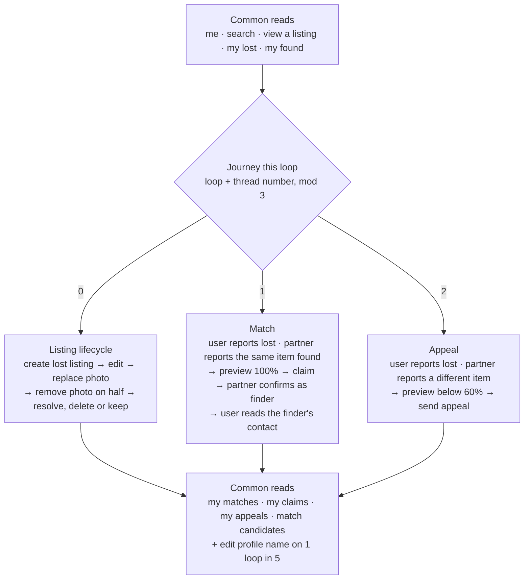
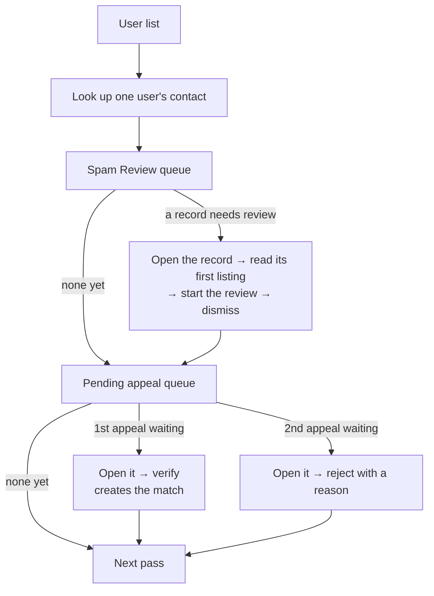
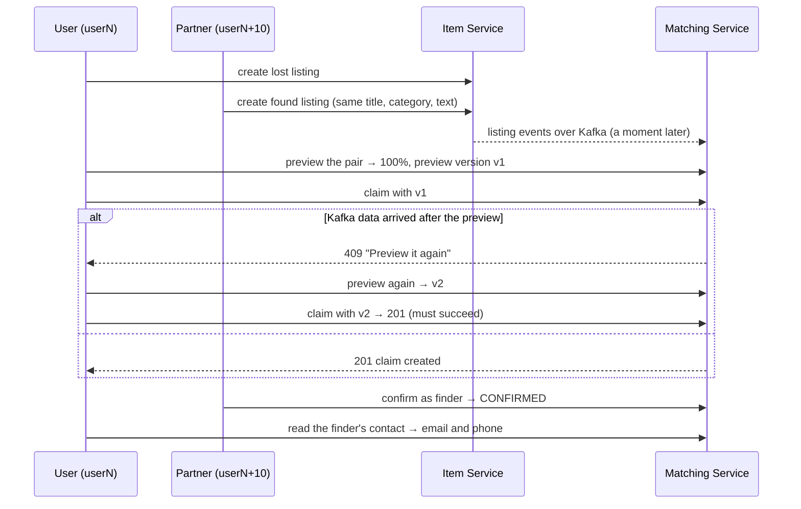
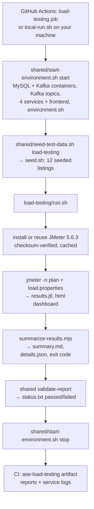

# Load and performance testing

## Abstract

This folder is the load-testing stage of the ASE testing pipeline. An Apache JMeter plan drives realistic, concurrent traffic through all four Lost & Found microservices (Auth, Item, Matching, Admin Verify) in a fresh, throwaway environment:

- 20 steady users with think time, who report, edit, photograph, resolve, delete, claim and appeal listings;
- a 20-user spike with no think time;
- an admin who reviews spam records and decides appeals while the users work.

One command runs the 80-second profile. That command is `run.sh`, the same in GitHub Actions and locally. Every run is judged automatically on error rate, p95 response time per endpoint, and coverage (every journey really ran), and produces the pipeline's shared report format (`summary.md`, `details.json`) plus JMeter's raw results and HTML dashboard.

A typical run sends about 60,000–75,000 requests to 34 endpoints with 0 errors and passes all 52 checks. The load-testing job passes on GitHub Actions.

Shared setup, the CI workflow and the reporting contract are described in [`../README.md`](../README.md).

## Contents

1. [What the test does](#what-the-test-does)
2. [Design choices and why](#design-choices-and-why)
3. [Why the deployed system is not load-tested](#why-the-deployed-system-is-not-load-tested)
4. [How a run is judged](#how-a-run-is-judged)
5. [How it fits the pipeline](#how-it-fits-the-pipeline)
6. [Reading the output](#reading-the-output)
7. [Reports](#reports)
8. [Files and scripts](#files-and-scripts)
9. [Running it](#running-it)
10. [How it was tested during development](#how-it-was-tested-during-development)
11. [Typical results](#typical-results)
12. [Assessment-branch note](#assessment-branch-note)

## What the test does

### The 80-second profile

```mermaid
gantt
    title Load profile (config/load.properties)
    dateFormat X
    axisFormat %M:%S
    section Steady users (20)
    Ramp-up, one user joins per second   :s1, 0, 20s
    Peak, all 20 with think time         :s2, after s1, 40s
    section Spike users (20)
    All start together, no think time    :p1, 60, 20s
    section Admin (1)
    Admin journey for the whole run      :a1, 0, 80s
```



| Time | What happens | Live banner |
|---|---|---|
| 0 s | Steady users start joining (one per second); the admin starts | `START` |
| 20 s | All 20 steady users are running; peak until 60 s | `STEADY PEAK` |
| 60 s | Steady users stop; 20 spike users start within 1 s, with no think time | `SPIKE` |
| 80 s | Everything stops; thresholds are checked and reports written | `FINISHED` |

Every user logs in once through Auth's real login endpoint and sends the returned JWT on every later request. Steady users wait 0.5–1.5 s (uniform random) between requests, like a person reading a page. The admin waits 1 s.

### What each steady user does per loop

Each steady user (`user1`–`user20`) has a **partner** account (user N+10), which plays the other person in the match and appeal journeys. Each loop runs one of three journeys, rotating by loop number and thread number, so all three run side by side from the first loop.



### What the spike does

The spike's 20 users run the read-heavy part of the same journey with no think time: me, search, view, my lost, my found, my matches, my claims, my appeals. On 1 loop in 10 they also create a listing. It shows how the services behave when traffic jumps suddenly.

### What the admin does per pass



The spam records and appeals the admin works on are created by the steady users during the same run.

### Endpoints (34, named exactly like this in the results)

| Service | Endpoints |
|---|---|
| Auth (5) | `Auth - login`, `Auth - me`, `Auth - edit profile`, `Auth - admin user list`, `Auth - admin user lookup` |
| Item (12) | `Item - search`, `Item - view listing`, `Item - my lost reports`, `Item - my found reports`, `Item - create lost listing`, `Item - edit lost listing`, `Item - replace photo`, `Item - remove photo`, `Item - resolve lost listing`, `Item - delete lost listing`, `Item - create found listing`, `Item - admin listing read` |
| Matching (13) | `Matching - my matches`, `Matching - my claims`, `Matching - my appeals`, `Matching - candidates`, `Matching - preview`, `Matching - claim`, `Matching - finder confirm`, `Matching - return contact`, `Matching - send appeal`, `Matching - admin appeal list`, `Matching - admin appeal detail`, `Matching - admin appeal verify`, `Matching - admin appeal reject` |
| Admin Verify (4) | `AdminVerify - spam review list`, `AdminVerify - spam record detail`, `AdminVerify - open spam record`, `AdminVerify - dismiss spam record` |

### Not tested, by design

- **Registration, email verification and password reset:** they need real email delivery, which the test environment deliberately doesn't have.
- **Spam Solve and kick:** they act on a user and that user's listings while the steady users are still using them, so they would break other journeys mid-run. Open and dismiss only change the record.
- **Account deletion:** it would remove a user that other threads log in as.
- **Waiting for Kafka:** events (for example a confirmed match marking listings as matched) are published and handled asynchronously; the test checks the HTTP response and moves on, and never touches a listing again after handing it to Kafka.
- **The frontend:** UI behaviour belongs to the UI/E2E stage; this stage calls the APIs directly.

## Design choices and why

| Choice | Why |
|---|---|
| **One plan, one Test Fragment per service**, steps called from the journeys through Module Controllers | Each request is defined once (URL, body, assertions, extractors) and reused by every journey and thread group, so a change to an endpoint is made in one place. Same-named Summarisers inside each fragment give one live line per service. |
| **Real login, once per user** (Once Only Controller), JWT extracted and sent as `Bearer` | Exercises Auth for real (BCrypt hashing, token issue) without turning the run into a login benchmark. Every later request is authenticated the same way the frontend does it. |
| **Think time 0.5–1.5 s for steady users, none for the spike** | Steady users behave like people reading pages; the spike is the worst case where everyone hammers at once. The contrast is visible in the live output and the results. |
| **Ramp, peak, spike, with the admin throughout** | Ramp-up shows behaviour as load grows, the peak shows sustained load, the spike shows a sudden jump, and the admin shows a different kind of user working alongside. 80 s keeps a live demo short while giving every journey several runs. |
| **Partner accounts in `users.csv`** (user N's partner is user N+10) | A match needs two different people (a claim on your own listings is rejected). Every account is both a user and a partner, and no two threads ever share a listing, so the journeys can't collide. |
| **Journey rotation by loop number + thread number** | All three journeys run at the same time from the first loop, with no randomness. |
| **Listing endings and photo removal from a shared counter** (`__counter`), not random | Any 3 lifecycle loops in a row cover resolve, keep and delete, and the first one already removes a photo. A random pick once produced 0 resolves in a CI run and failed coverage; nothing in the plan depends on chance. |
| **"View a listing" picks only seeded listings** (JSONPath filter on the `(seed …)` title) | Steady users delete their own new listings, so viewing one of those could race a delete and return 404. Seeded listings are never edited or deleted. |
| **Claim and appeal: on 409 "preview it again", preview again and resubmit once** | The preview version includes data Matching receives over Kafka a moment after a listing is created, so a preview taken immediately can go stale. That is the app's documented answer, and the UI does the same. The first try accepts 201 or 409 ("Ignore status" on, because JMeter marks 4xx as failed before assertions run); the retry must return 201, and any other code fails. |
| **Admin listing read accepts 200 or 404** | The listing a spam record points to may already have been deleted by its owner, which the admin page also shows as deleted. Anything other than 200 or 404 fails. |
| **Two appeal decisions per admin pass** (verify the first pending appeal, reject the second) | Both verify and reject run in every run once two appeals are waiting, rather than depending on which pass finds them. |
| **Spike stays read-heavy** (creates on 10% of loops, no edits, deletes or claims) | Real bursts are mostly browsing. Writes at spike speed would flood the spam rule and the match tables and measure something unrealistic. |
| **Assertions on every request** (status code, plus a JSON field or value where it proves the right thing happened, for example `$.status == CONFIRMED`) | A fast wrong answer must count as a failure, not as a good response time. |
| **Coverage check** | The summary fails the run if any thread group didn't run or any expected endpoint has 0 requests, so a broken If Controller or extractor can't silently skip part of the plan. |
| **Phase banners printed by existing threads** (JSR223 pre-processors) | A separate banner thread group would add a thread to the live "Active/Started" counts. These print once each and record no sample. |
| **Thresholds calibrated from measured runs** (see [How a run is judged](#how-a-run-is-judged)) | Limits are tight enough to catch a real slowdown but leave room for slower CI runners. |
| **A fresh, disposable environment for every run** | Results are repeatable and nothing outside the run is touched. |

### The match journey in detail



## Why the deployed system is not load-tested

- **No test accounts there.** The 20 users, the partners and the admin exist only in the Development seed of the test environment.
- **It would change live data.** Every run creates hundreds of listings, claims, appeals and spam records, which real users and admins would see, and it would trigger real spam alerts and emails.
- **It could take the live site down.** The services run on Azure App Service's Free (F1) tier, with a daily CPU quota; a spike of 20 users with no think time could use it up and stop the site for everyone.
- **It would break the pipeline's contract.** Each stage starts its own environment, so results are repeatable and independent of whatever else is happening. Live traffic, cold starts and network distance would make the numbers unrepeatable and the thresholds meaningless.

## How a run is judged

`scripts/summarize-results.mjs` checks the results against `config/thresholds.json` and fails the run (exit code 1) if any check fails:

- **Error rate:** at most 1% of requests may fail, overall, per thread group and per endpoint. A request fails if its status code or any of its assertions is wrong.
- **p95 response time per endpoint:** 95% of an endpoint's requests must finish within its limit. Each thread group has a default (steady 300 ms, spike 1000 ms, admin 1500 ms), and slower operations have their own limits:
  - **logins:** 1200 ms steady, 5000 ms spike (20 BCrypt hashes at once queue on a 2–4 core CI runner);
  - **writes:** 1000 ms, or 2000 ms for replace photo and for writes with 10 or fewer requests per run.
- **Coverage:** every expected thread group ran and called each of its expected endpoints at least once (23 steady, 10 spike, 12 admin).

**How the limits were set:** from three local runs of the 80 s profile plus the CI runs seen so far. Each limit is the larger of about 5× the worst local p95 and about 1.5× the worst CI p95, rounded up.
- **Writes with 10 or fewer requests per run** get extra room, because with so few samples p95 is simply the slowest single request.
- **Replace photo** does too: the first uploads on a cold CI runner took up to 1155 ms.

52 checks in total: 1 overall, 3 coverage, 3 thread groups, and 45 endpoint rows (34 endpoints, some used by more than one thread group).

## How it fits the pipeline



- **One test entry point:** `run.sh`. CI and local runs call the same script with the same environment variables, so a local pass means the same checks as on CI.
- **Unified reporting:** like every stage, it writes `summary.md`, `details.json` and `status.txt`, which the shared `validate-report` checks. In GitHub Actions, `summary.md` is also added to the run's summary page.
- **Isolation:** the job runs on its own runner with its own MySQL, Kafka and services, in parallel with mutation and UI/E2E once unit testing has finished. Nothing is shared between stages.
- **Why `run.sh` doesn't start the environment:** the workflow starts it, runs the stage and stops it as separate steps, and the framework forbids starting it twice (fixed ports). Keeping them apart also lets you start once and run several times locally (a warm-up, then the demo).

## Reading the output

### Live progress (every 5 seconds)

```
=====  20 s | STEADY PEAK: all 20 steady users running until 60 s =====
Item +     56 in 00:00:06 =   10.0/s Avg:     8 Min:     1 Max:    26 Err:     0 (0.00%) Active: 21 Started: 21 Finished: 0
Item =    401 in 00:00:58 =    6.9/s Avg:     8 Min:     1 Max:    37 Err:     0 (0.00%)
summary +    716 in 00:00:06 =  121.1/s Avg:     5 Min:     1 Max:   219 Err:     0 (0.00%) Active: 13 Started: 33 Finished: 20
```

| Part | Meaning |
|---|---|
| `=====  20 s \| …` | **Phase banner**, printed once per phase change with the seconds since the start: `START`, `STEADY PEAK`, `SPIKE`, and `FINISHED` after the run. |
| `Auth`, `Item`, `Matching`, `AdminVerify` | One line per **service**: every request to that service, from all thread groups. |
| `summary` | JMeter's line for **all requests together**. |
| `+` | The **last interval** only (about 5 s). Use it to see the load right now. |
| `=` | The **running total** since the start. |
| `56 in 00:00:06` | Requests completed in that interval or total, and the time it covers. |
| `= 10.0/s` | Throughput: requests per second. It jumps at the spike. |
| `Avg / Min / Max` | Response time in ms for those requests. One slow request moves `Max` but hardly moves `Avg`. |
| `Err: 0 (0.00%)` | Failed requests (wrong status or failed assertion). It should stay at 0. |
| `Active / Started / Finished` | Users currently running, started so far and finished, across all thread groups (20 steady + 20 spike + 1 admin = 41). During the ramp, `Started` climbs by one per second; at 60 s the steady users finish and the spike starts. |

### After the run

The shared validator prints one line per check, then `summary.md`:

```
[passed] Coverage: Admin: This thread group must run and call all 12 expected endpoints (listed in config/thresholds.json), so no part of the plan is silently skipped.
[passed] Users - steady | Matching - claim: Claims a 100% pair from its preview; expects 201 (…). Passes when p95 ≤ 1000 ms and no more than 1% fail.
[passed] Users - spike | Item - search: Same request as in Users - steady. Passes when p95 ≤ 1000 ms and no more than 1% fail.
**Result: PASSED (52 checks)**
```

Each line is `[status] check name: what it checks. The limit it was held to.` A failed check also prints `Details:` with the cause, for example `p95 1155 ms (limit 1000 ms)` or `2.22% failed (limit 1%); e.g. 404 …`.

## Reports

Every run writes to `$ASE_REPORT_ROOT/load-testing/`. In GitHub Actions, the same folder plus the service logs is uploaded as the **`ase-load-testing`** artifact (Actions → the run → Artifacts; kept 14 days).

### `summary.md`, the human-readable report

- **Result line:** `PASSED (52 checks)` or `FAILED (n of 52 checks)`.
- **Scope:** the thread groups and their user counts, the duration, and the endpoint count (`34 distinct, 45 checked across the thread groups`).
- **Totals:** all requests, failures, overall throughput and overall p95.
- **Thresholds:** one pass/fail line each for error rate, p95 and coverage.
- **Coverage:** per thread group, "all N expected endpoints recorded", or the missing ones.
- **Endpoints table:** one row per thread group and endpoint, in journey order.

  | Column | Meaning |
  |---|---|
  | Thread group, Endpoint, Path | Who called it, its name, and its URL with ids replaced by `{id}` |
  | Requests, Errors | How many were sent and how many failed |
  | p50, p90, p95, p99 ms | Half, 90%, 95% and 99% of requests finished within this time. p95 is the one judged; p99 shows the slow tail. |
  | Req/s | That endpoint's throughput while it was being called |
  | p95 limit, Result | The limit from `thresholds.json` and whether it passed |
- **Failures:** only when something failed. Each failed check, with the cause and up to 3 example error messages.

### `details.json`, the machine-readable report

`{"cases": [ … ]}`, one case per check, in the same order as the printed lines. The shared validator reads it.

| Field | Meaning |
|---|---|
| `name`, `description`, `status` | The check, what it checks, and `passed` or `failed` |
| `users`, `requests`, `errors`, `errorRatePercent` | How many users took part, how many requests were made, and how many failed |
| `p50Ms`, `p90Ms`, `p95Ms`, `p99Ms`, `maxMs` | Response-time percentiles and the slowest request |
| `throughputPerSec` | Requests per second |
| `endpoint` | The URL path, ids as `{id}` (endpoint checks) |
| `threshold` | The limits applied: `p95MaxMs`, `errorRateMaxPercent` |
| `expectedEndpoints`, `recordedEndpoints` | What should have run and what did (coverage checks) |
| `error` | Present only on failure: the reason and examples |

### `results.jtl`, JMeter's raw results

A CSV with one row per request: the source for everything else. The useful columns are:
- `timeStamp`, `elapsed` (ms);
- `label` (the endpoint name);
- `responseCode`, `success`, `failureMessage`;
- `threadName` (for example `Users - steady 1-4`);
- `grpThreads` (users running in that group at that moment);
- `URL`;
- `Latency` and `Connect` (time to first byte and connection time).

It's useful for digging into a single failure (filter by `label` and `success=false`).

### `html/index.html`, JMeter's dashboard

Built by JMeter from `results.jtl` at the end of the run. Open it in a browser.

- **Dashboard:**
  - **APDEX:** a satisfaction score per endpoint.
  - **Requests Summary:** the pass/fail pie.
  - **Statistics:** per endpoint, with count, errors, average, min, max, percentiles and throughput.
  - **Errors** and **Top 5 Errors by sampler.**
- **Charts → Over Time:**
  - **Response Times Over Time:** the spike shows as the jump at 60 s.
  - **Active Threads Over Time:** shows the ramp, peak, spike and admin.
  - **Bytes Throughput** and **Latencies** over time.
- **Charts → Throughput:** hits, codes and transactions per second, and response time versus request rate.
- **Charts → Response Times:** response-time percentiles and the distribution.

### Other files

| File | Contents |
|---|---|
| `status.txt` | `passed` or `failed`: the stage's final state, written by the exit handler |
| `console.log` | Everything printed during the run: banners, live lines, check lines and `summary.md` |
| `jmeter.log` | JMeter's own log (plan loading, warnings); look here if JMeter itself fails |
| CI artifact only: `ase-environment/logs/` | Each service's log (`AuthService.log`, `ItemService.log` and so on) and the containers' log, for server-side errors behind a failed request |

## Files and scripts

| File | What it is and does |
|---|---|
| `run.sh` | **The only test entry point** (CI and local).<br>1. Checks the four service URLs are set.<br>2. Installs JMeter 5.6.3 once (SHA-512 checked, cached in `~/.cache/ase-load-testing` or `ASE_JMETER_CACHE`).<br>3. Runs the plan headless (`jmeter -n`) with the environment's hosts and ports, writing `results.jtl`, `jmeter.log` and the HTML dashboard.<br>4. Prints `FINISHED`, then runs the summary script.<br>5. Its exit handler runs the shared `validate-report` and writes `status.txt`.<br>The exit code is non-zero if JMeter fails or any check fails. It refuses to overwrite an earlier run's results. |
| `local-run.sh` | **Local convenience only; CI doesn't use it.** `start` (fresh environment + seed, remembered for later commands), `run` (fresh report folder, then `run.sh`, then opens the dashboard), `stop`, and `all` (start, run and stop in one go). See [Running it](#running-it). |
| `seed.sh` | Scenario data, run by the shared `seed-test-data.sh load-testing`. Logs in the first 6 users through the real API and creates 1 lost and 1 found listing each (12 in total, titles ending in `(seed <runId>)`), so search and view have data from the first request. Two per user stays below the spam rule (3 within 60 minutes). |
| `plans/lost-and-found-load.jmx` | The JMeter plan.<br>**Variables:** User Defined Variables built from properties (hosts, ports, data folder, think times).<br>**Shared settings:** HTTP defaults (HttpClient4, 10 s connect and 30 s response timeouts) and an `Accept: application/json` header.<br>**Four Test Fragments** (Auth, Item, Matching, AdminVerify), one step per request, each with its Summariser, sampler, assertions and extractors.<br>**Three thread groups:** `Users - steady`, `Users - spike` and `Admin`, each logging in once and then looping its journey through Module Controllers. |
| `config/load.properties` | The profile: users, ramp, peak, spike and admin lengths, think times, the spike's create share, and `summariser.interval=5`. Any value can be overridden with `-J<name>=<value>`. |
| `config/thresholds.json` | The pass/fail rules: error rate, p95 limits per thread group and endpoint, and the `expected` endpoint lists for coverage. Its `description` records how the limits were calibrated. |
| `scripts/summarize-results.mjs` | Reads `results.jtl`; works out statistics overall, per thread group and per endpoint; checks error rate, p95 and coverage; writes `summary.md` and `details.json`. Exits 1 if any check fails or nothing was recorded. It handles very large results files (a run where everything fails instantly can record hundreds of thousands of rows). |
| `data/users.csv` | `email,password,partner_email,partner_password` for `user1`–`user20` (Development seed accounts, test-only passwords). Each row's partner is user N+10. |
| `data/admin.csv` | `admin1` login details |
| `data/search-terms.csv` | Search word, category and type combinations, so searches vary instead of repeating one cached query |
| `data/listing-photo.jpg` | A 1 KB JPEG used for photo replacement |

**Shared scripts** in `../shared/` belong to the framework and aren't changed by this stage:
- **`start-environment.sh start`:**
  - starts MySQL (port 3307) and Kafka (19092) with `docker-compose.yml`;
  - creates the databases and the Kafka topics the services consume;
  - builds and starts Auth (5261), Item (5001), Matching (5179), Admin Verify (5003) and the frontend (5173) in Development (migrations run; Auth seeds the users and admin);
  - writes `environment.sh`.
- **`start-environment.sh stop`:** stops everything and removes the containers (no volumes); the logs are kept.
- **`start-environment.sh validate-report load-testing`:** checks the report format and prints the check lines.
- **`seed-test-data.sh load-testing`:** runs this folder's `seed.sh`.

## Running it

### In GitHub Actions

The workflow runs on every push that changes `services/`, `frontend/`, `testing-pipeline/` or the workflow itself. To run only this stage: Actions → **ASE testing pipeline** → Run workflow → `load-testing` (or `all`). Results: the job log (live lines and check lines), the run's summary page (`summary.md`), and the `ase-load-testing` artifact.

### Locally (WSL2)

One-time machine setup (WSL2 Ubuntu, Docker, .NET SDK, Node, Java 17+): see **Local setup on Windows (WSL2)** in the [DevOps documentation](../../DevOps_Documentation/ASE-Testing-Pipeline.md). Then, from the repository root in a WSL terminal:

```bash
bash testing-pipeline/load-testing/local-run.sh start   # fresh environment + seed (about 1.5 minutes)
bash testing-pipeline/load-testing/local-run.sh run     # one run (about 85 s); repeat as often as needed
bash testing-pipeline/load-testing/local-run.sh stop    # stop the environment
```

- **Keep the same terminal open between `start` and `run`.** The services are processes of that WSL session; if the session ends (for example a one-off `wsl -- bash -c …` command), they stop and every request fails with "connection refused", although the containers are still up. From scripts or one-off commands, use `bash testing-pipeline/load-testing/local-run.sh all`, which starts, runs and stops in one session.
- **Warm-up:** the first run on a newly started environment can be slower (cold database and JIT). For a demo, do one `run` first.
- **`ASE_LOCAL_REPORTS=<folder>`:** keeps each run's reports in `<folder>/load-report-<date>_<time>/` instead of a temporary folder. Choose a git-ignored folder, because reports shouldn't be committed.
- **`ASE_OPEN_REPORT=false`:** doesn't open the dashboard in the Windows browser after a run.
- **`start` refuses to start a second environment** while one is recorded (the ports are fixed). Only one environment can run per machine, so `stop` this one before running UI/E2E tests locally.

**Without the helper**, the same steps are:

```bash
export ASE_RUNTIME_DIR="$(mktemp -d -t ase-environment.XXXXXX)"
export ASE_COMPOSE_PROJECT=ase-testing-local
bash testing-pipeline/shared/start-environment.sh start
source "$ASE_RUNTIME_DIR/environment.sh"
bash testing-pipeline/shared/seed-test-data.sh load-testing
export ASE_REPORT_ROOT="$(mktemp -d -t ase-reports.XXXXXX)"   # after sourcing; fresh for every run
bash testing-pipeline/load-testing/run.sh
bash testing-pipeline/shared/start-environment.sh stop
```

**Changing the load:** pass JMeter properties through `run.sh`, for example a longer peak with `bash testing-pipeline/load-testing/run.sh -Jsteady_peak_seconds=120`. Thresholds are calibrated for the default profile.

## How it was tested during development

The plan was built in small steps. Each step was a complete, working plan, checked the same way:

1. **Static checks:** the plan parses as XML, `thresholds.json` parses as JSON, and `node --check` passes on the summary script.
2. **A full local run** with `local-run.sh all`: a fresh environment, the full 80 s profile and the shared report validator. All checks must pass with 0 errors, and the new endpoints must appear in coverage.
3. **Commit and push, then the CI run** on GitHub Actions.
4. **On a failure,** the cause was found in the report or `results.jtl` (for example per-thread request order), fixed, and steps 1–3 were repeated.

Fixes found this way are part of the design above:
- the seeded-listing filter (a delete race on CI);
- the preview retry (stale previews);
- "Ignore status" on the retry assertions;
- the shared counter for listing endings (a random pick skipped an ending on CI);
- the admin read accepting 404;
- the summary script handling very large results files.

Changes to the summary script were also checked offline by re-summarising saved `results.jtl` files, including a deliberately oversized one (about 337,000 rows).

## Typical results

Three calibration runs locally (WSL2) plus CI, 80 s profile:
- **Overall:** 52 of 52 checks pass, about 58,000–74,000 requests, 0 errors.
- **Steady users:**
  - **Reads:** p95 3–9 ms.
  - **Writes** (create, edit, photo, resolve, delete, claim, confirm, appeal): p95 about 20–35 ms, and up to about 165 ms on a slower run.
  - **Login:** about 190–225 ms, because BCrypt hashing is deliberately CPU-heavy.
- **Spike users:** about 9,000–11,000 requests per endpoint in 20 s. Reads stay at p95 4–14 ms with 0 errors; creates p95 about 45–225 ms.
- **Admin:** reads p95 10–75 ms; open, dismiss, verify and reject 30–300 ms.
- **On GitHub's runner:** reads are similar.
  - **The spike's 20 simultaneous logins** queue on 2–4 cores (p95 about 2 s).
  - **The first photo uploads on a cold runner** took about 1.2 s.
  - Both are inside their limits.

## Assessment-branch note

Auth's login rate limit is raised from 10 to 1000 per 5 minutes on `ASE/Assignment` only, so every user and partner can log in on every run. See "Changes after the original implementation", change 4, in the [DevOps documentation](../../DevOps_Documentation/ASE-Testing-Pipeline.md). Production keeps 10 per 5 minutes.
